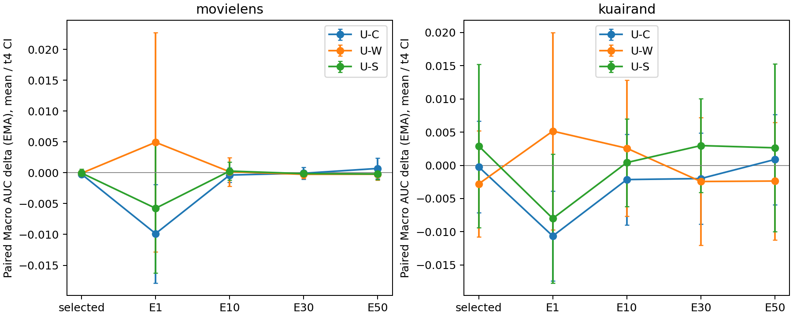
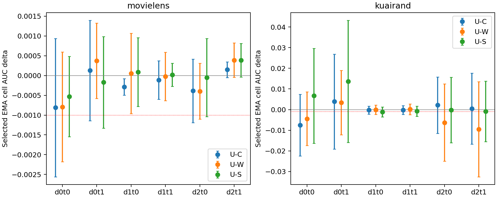

# C05 CELL-MASS-BCE-025：完整研究报告

结论：NO_CONTINUATION_SIGNAL。按预先固定的 selected fixed_ema 主终点，U−C 在 MovieLens 和 KuaiRand 的五 seed 平均 Macro AUC 都非正，均未达到 +0.003。ML 六 cell 保护门槛通过，KR d0t0 未通过 −0.001 保护线。两套数据的平均 validation LL 也均未下降。此为当前协议的筛选结果，不能解释为已经证明总体效应严格为零。

本轮已完成 DESIGN→IMPLEMENT→独立 REVIEW→RUN→主智能体 ANALYZE：10条新 U 轨迹各50 epochs、500次已确认提交、17250次有用 Adam/EMA 更新。复用 C/W/S 数值控制30条，共40条唯一轨迹；统计单位始终是五个配对 seed。原始前台父智能体直接 get 验收20个选中模型，实际张量95508960字节。Test 未开启，未选择 champion。本轮按用户最终指令交付后停止，不启动 C06。

完整定义与固定协议见 [METHODS.md](METHODS.md)，全部逐 seed / stage / cell 绝对值见 [NUMERICAL_APPENDIX.md](NUMERICAL_APPENDIX.md)，工程失败、恢复与来源修正见 [EXECUTION_HISTORY.md](EXECUTION_HISTORY.md)。所有区间为 n=5、ddof1 的描述性 t4 区间，相关探索比较未作多重校正。

## 1. 主终点与逐 seed 结果

| dataset | U−C selected EMA | mean | SD | 95% CI | + / − seeds |
|---|---|---|---|---|---|
| movielens | macro_auc | -0.000221160 | +0.000325190 | [-0.000624936, +0.000182617] | 1/4 |
| movielens | macro_logloss | +0.000320050 | +0.001756359 | [-0.001860758, +0.002500857] | 4/1 |
| kuairand | macro_auc | -0.000235705 | +0.005565252 | [-0.007145879, +0.006674468] | 4/1 |
| kuairand | macro_logloss | +0.000576420 | +0.002805386 | [-0.002906927, +0.004059767] | 4/1 |

| dataset | seed | U AUC | C AUC | 差值 | U选中epoch | C选中epoch |
|---|---|---|---|---|---|---|
| movielens | 2022 | 0.7593286455576997 | 0.759989847390091 | -0.0006612018323912672 | 21 | 23 |
| movielens | 2023 | 0.7597499776533266 | 0.7598563941542452 | -0.00010641650091858246 | 20 | 19 |
| movielens | 2024 | 0.7594879008153738 | 0.7597107580310897 | -0.00022285721571591033 | 22 | 20 |
| movielens | 2025 | 0.7593651642938776 | 0.7597080668052727 | -0.00034290251139512673 | 21 | 28 |
| movielens | 2026 | 0.7598036330329835 | 0.759576054298399 | 0.00022757873458445488 | 22 | 21 |
| kuairand | 2022 | 0.6907577298343588 | 0.689911209226755 | 0.0008465206076038179 | 46 | 44 |
| kuairand | 2023 | 0.6955216503789557 | 0.6949642441109117 | 0.0005574062680440139 | 41 | 39 |
| kuairand | 2024 | 0.6855810197866097 | 0.6953435663195054 | -0.009762546532895766 | 30 | 32 |
| kuairand | 2025 | 0.6921209807547258 | 0.6875174163013895 | 0.004603564453336317 | 44 | 50 |
| kuairand | 2026 | 0.690330298794909 | 0.6877537699001156 | 0.0025765288947934284 | 50 | 37 |

ML 为1正4负；KR 为4正1负，但 seed2024 的差值−0.009762547使总体均值转负。该 seed 的 U/C 选点分别为epoch30/32，均遵循独立最早严格最大 AUC；不删除该点、不改用中位数替换主均值，也不以其他 seed 的方向投票重写主判定。KR 区间宽且跨零，疗效方向证据为 WEAK；ML 区间同样跨零，不能把小负均值直接写成确定伤害。未达到预设门槛这一运行内事实为 STRONG。

## 2. 绝对表现与模型 stream

| dataset | arm | stream | AUC mean | AUC SD | LL mean | LL SD | 平均选中epoch |
|---|---|---|---|---|---|---|---|
| movielens | CLEAN | online | 0.756771774902076 | 0.0001724433660685485 | 0.5267180062691247 | 0.003181432704972577 | 21.0 |
| movielens | CLEAN | fixed_ema | 0.7597682241358196 | 0.00015869886815021223 | 0.5246900355875679 | 0.0010250990545764447 | 22.2 |
| movielens | MASS-SCALE-025 | online | 0.7569260433626973 | 0.00045259252619619174 | 0.5260700535985975 | 0.0025876030735223926 | 24.6 |
| movielens | MASS-SCALE-025 | fixed_ema | 0.7595902730367403 | 0.0003475974220352649 | 0.5256933318235237 | 0.00018606564010788408 | 23.2 |
| movielens | COMPLETION-BCE-025 | online | 0.7568965235411461 | 0.0005262925188234347 | 0.5257931270137146 | 0.0016079999472197854 | 22.4 |
| movielens | COMPLETION-BCE-025 | fixed_ema | 0.7596136026881868 | 0.00039598122240563926 | 0.5243847191141194 | 0.002183703476096144 | 22.8 |
| movielens | CELL-MASS-BCE-025 | online | 0.75672808432619 | 0.0004430351769395831 | 0.5264103125995782 | 0.0017219731793700083 | 23.4 |
| movielens | CELL-MASS-BCE-025 | fixed_ema | 0.7595470642706522 | 0.00021868700283252451 | 0.5250100852531246 | 0.0025423403494933814 | 21.2 |
| kuairand | CLEAN | online | 0.6894542137287911 | 0.0035756636308192503 | 0.4288290295675423 | 0.0037441394999638273 | 37.0 |
| kuairand | CLEAN | fixed_ema | 0.6910980411717355 | 0.003820523649095453 | 0.4286395718731211 | 0.001599378616521517 | 40.4 |
| kuairand | MASS-SCALE-025 | online | 0.6848660729507666 | 0.0062657989510912955 | 0.42826392279622877 | 0.004449430468810877 | 42.2 |
| kuairand | MASS-SCALE-025 | fixed_ema | 0.687954420116448 | 0.006541191673840472 | 0.42831827472323986 | 0.0019466695750731732 | 42.2 |
| kuairand | COMPLETION-BCE-025 | online | 0.6918067527290822 | 0.003916873464191803 | 0.4250756764533603 | 0.002926744597556695 | 40.0 |
| kuairand | COMPLETION-BCE-025 | fixed_ema | 0.6936531269050538 | 0.0037917575849150107 | 0.42469723754740407 | 0.0024530289632638523 | 42.4 |
| kuairand | CELL-MASS-BCE-025 | online | 0.6894583424150393 | 0.0036048785539196074 | 0.4287859460653418 | 0.0019597870452713055 | 41.8 |
| kuairand | CELL-MASS-BCE-025 | fixed_ema | 0.6908623359099119 | 0.0035874679121858785 | 0.4292159916375593 | 0.0018054731510404 | 42.2 |

U_ema−C_online 的 ML AUC 为+0.002775289，五 seed 均正且描述性区间全正；但 matched EMA 主比较为负。固定 EMA 在 CLEAN 自身也提供收益，跨 stream 优势不能归因于 U 或替代主终点。U_online−C_online 的 ML/KR AUC 分别−0.000043691/+0.000004129，区间均跨零；online 也未提供稳定救援。

## 3. 六个 cell、domain 与 task

| dataset | U−C selected EMA 指标 | mean | 95% CI | 有利seed |
|---|---|---|---|---|
| movielens | d0t0_auc | -0.000809110 | [-0.002556336, +0.000938116] | 2/5 |
| movielens | d0t0_logloss | +0.000799973 | [-0.003552473, +0.005152419] | 2/5 |
| movielens | d0t1_auc | +0.000127008 | [-0.001139585, +0.001393601] | 2/5 |
| movielens | d0t1_logloss | -0.000233660 | [-0.000650426, +0.000183106] | 4/5 |
| movielens | d1t0_auc | -0.000288488 | [-0.000494179, -0.000082798] | 0/5 |
| movielens | d1t0_logloss | -0.000176356 | [-0.001694186, +0.001341474] | 3/5 |
| movielens | d1t1_auc | -0.000115640 | [-0.000600861, +0.000369581] | 2/5 |
| movielens | d1t1_logloss | -0.000834813 | [-0.002640978, +0.000971351] | 3/5 |
| movielens | d2t0_auc | -0.000387491 | [-0.001189624, +0.000414643] | 1/5 |
| movielens | d2t0_logloss | +0.002169940 | [-0.004672026, +0.009011907] | 2/5 |
| movielens | d2t1_auc | +0.000146762 | [-0.000053320, +0.000346843] | 5/5 |
| movielens | d2t1_logloss | +0.000195214 | [-0.002471634, +0.002862062] | 2/5 |
| movielens | domain0_macro_auc | -0.000341051 | [-0.001544863, +0.000862761] | 2/5 |
| movielens | domain0_macro_logloss | +0.000283157 | [-0.002034942, +0.002601255] | 2/5 |
| movielens | domain1_macro_auc | -0.000202064 | [-0.000421599, +0.000017470] | 1/5 |
| movielens | domain1_macro_logloss | -0.000505585 | [-0.001647645, +0.000636475] | 3/5 |
| movielens | domain2_macro_auc | -0.000120364 | [-0.000548824, +0.000308095] | 2/5 |
| movielens | domain2_macro_logloss | +0.001182577 | [-0.003539840, +0.005904994] | 2/5 |
| movielens | task0_macro_auc | -0.000495030 | [-0.001153339, +0.000163279] | 0/5 |
| movielens | task0_macro_logloss | +0.000931186 | [-0.002983739, +0.004846110] | 1/5 |
| movielens | task1_macro_auc | +0.000052710 | [-0.000473053, +0.000578473] | 2/5 |
| movielens | task1_macro_logloss | -0.000291086 | [-0.000930778, +0.000348605] | 3/5 |
| kuairand | d0t0_auc | -0.007526250 | [-0.022484568, +0.007432068] | 1/5 |
| kuairand | d0t0_logloss | +0.001594229 | [-0.000747565, +0.003936022] | 1/5 |
| kuairand | d0t1_auc | +0.003892377 | [-0.019086948, +0.026871702] | 2/5 |
| kuairand | d0t1_logloss | +0.000015632 | [-0.002081160, +0.002112424] | 2/5 |
| kuairand | d1t0_auc | -0.000255336 | [-0.002131335, +0.001620663] | 2/5 |
| kuairand | d1t0_logloss | +0.003122683 | [-0.000229424, +0.006474791] | 1/5 |
| kuairand | d1t1_auc | -0.000161582 | [-0.002296891, +0.001973728] | 3/5 |
| kuairand | d1t1_logloss | +0.002384061 | [+0.000712220, +0.004055902] | 0/5 |
| kuairand | d2t0_auc | +0.002189739 | [-0.011447420, +0.015826897] | 3/5 |
| kuairand | d2t0_logloss | -0.002085717 | [-0.012128293, +0.007956858] | 3/5 |
| kuairand | d2t1_auc | +0.000446821 | [-0.016715270, +0.017608911] | 2/5 |
| kuairand | d2t1_logloss | -0.001572369 | [-0.013809950, +0.010665213] | 2/5 |
| kuairand | domain0_macro_auc | -0.001816937 | [-0.017915497, +0.014281623] | 3/5 |
| kuairand | domain0_macro_logloss | +0.000804930 | [-0.000967316, +0.002577176] | 2/5 |
| kuairand | domain1_macro_auc | -0.000208459 | [-0.002142998, +0.001726080] | 3/5 |
| kuairand | domain1_macro_logloss | +0.002753372 | [+0.000308889, +0.005197855] | 1/5 |
| kuairand | domain2_macro_auc | +0.001318280 | [-0.013288288, +0.015924847] | 2/5 |
| kuairand | domain2_macro_logloss | -0.001829043 | [-0.012624389, +0.008966303] | 3/5 |
| kuairand | task0_macro_auc | -0.001863949 | [-0.007328303, +0.003600405] | 2/5 |
| kuairand | task0_macro_logloss | +0.000877065 | [-0.002478978, +0.004233108] | 1/5 |
| kuairand | task1_macro_auc | +0.001392539 | [-0.007725069, +0.010510146] | 4/5 |
| kuairand | task1_macro_logloss | +0.000275775 | [-0.003490922, +0.004042472] | 2/5 |

ML 的 d1t0 AUC 五 seed 均下降，描述性区间全负；d2t1 五 seed 均上升但区间跨零，不能只凭同号宣称确定收益。KR 最差保护 cell d0t0 平均−0.007526250、1正4负；d0t1 均值正但2正3负且区间极宽。cell、task 和 domain 的聚合回答不同问题，不用一个有利 cell 替代六 cell 主指标。

## 4. C/S/W/U 归因：F2 与 F3

| dataset | selected EMA 比较 | 指标 | mean | 95% CI | 有利seed |
|---|---|---|---|---|---|
| movielens | U_fixed_ema-W_fixed_ema | macro_auc | -0.000066538 | [-0.000315123, +0.000182046] | 2/5 |
| movielens | U_fixed_ema-W_fixed_ema | macro_logloss | +0.000625366 | [-0.003630244, +0.004880977] | 2/5 |
| movielens | U_fixed_ema-W_fixed_ema | task1_macro_logloss | +0.002255031 | [-0.000374259, +0.004884321] | 0/5 |
| movielens | U_fixed_ema-S_fixed_ema | macro_auc | -0.000043209 | [-0.000654459, +0.000568041] | 3/5 |
| movielens | U_fixed_ema-S_fixed_ema | macro_logloss | -0.000683247 | [-0.003644614, +0.002278121] | 2/5 |
| movielens | U_fixed_ema-S_fixed_ema | task1_macro_logloss | -0.000733901 | [-0.002687436, +0.001219634] | 3/5 |
| movielens | W_fixed_ema-S_fixed_ema | macro_auc | +0.000023330 | [-0.000761427, +0.000808086] | 2/5 |
| movielens | W_fixed_ema-S_fixed_ema | macro_logloss | -0.001308613 | [-0.004151199, +0.001533973] | 3/5 |
| movielens | W_fixed_ema-S_fixed_ema | task1_macro_logloss | -0.002988932 | [-0.004330420, -0.001647445] | 5/5 |
| movielens | S_fixed_ema-C_fixed_ema | macro_auc | -0.000177951 | [-0.000625940, +0.000270037] | 1/5 |
| movielens | S_fixed_ema-C_fixed_ema | macro_logloss | +0.001003296 | [-0.000160191, +0.002166783] | 0/5 |
| movielens | S_fixed_ema-C_fixed_ema | task1_macro_logloss | +0.000442815 | [-0.001387032, +0.002272662] | 2/5 |
| movielens | W_fixed_ema-C_fixed_ema | macro_auc | -0.000154621 | [-0.000719381, +0.000410138] | 2/5 |
| movielens | W_fixed_ema-C_fixed_ema | macro_logloss | -0.000305316 | [-0.002845119, +0.002234486] | 3/5 |
| movielens | W_fixed_ema-C_fixed_ema | task1_macro_logloss | -0.002546118 | [-0.005078657, -0.000013578] | 5/5 |
| kuairand | U_fixed_ema-W_fixed_ema | macro_auc | -0.002790791 | [-0.010796314, +0.005214732] | 3/5 |
| kuairand | U_fixed_ema-W_fixed_ema | macro_logloss | +0.004518754 | [+0.000286789, +0.008750720] | 0/5 |
| kuairand | U_fixed_ema-W_fixed_ema | task1_macro_logloss | +0.005837530 | [+0.000126805, +0.011548255] | 0/5 |
| kuairand | U_fixed_ema-S_fixed_ema | macro_auc | +0.002907916 | [-0.009364956, +0.015180788] | 4/5 |
| kuairand | U_fixed_ema-S_fixed_ema | macro_logloss | +0.000897717 | [-0.002959216, +0.004754650] | 1/5 |
| kuairand | U_fixed_ema-S_fixed_ema | task1_macro_logloss | +0.000712949 | [-0.002460791, +0.003886689] | 1/5 |
| kuairand | W_fixed_ema-S_fixed_ema | macro_auc | +0.005698707 | [-0.002396475, +0.013793889] | 4/5 |
| kuairand | W_fixed_ema-S_fixed_ema | macro_logloss | -0.003621037 | [-0.006636916, -0.000605159] | 5/5 |
| kuairand | W_fixed_ema-S_fixed_ema | task1_macro_logloss | -0.005124581 | [-0.009497163, -0.000751998] | 5/5 |
| kuairand | S_fixed_ema-C_fixed_ema | macro_auc | -0.003143621 | [-0.011084963, +0.004797721] | 2/5 |
| kuairand | S_fixed_ema-C_fixed_ema | macro_logloss | -0.000321297 | [-0.001646349, +0.001003754] | 2/5 |
| kuairand | S_fixed_ema-C_fixed_ema | task1_macro_logloss | -0.000437175 | [-0.001576407, +0.000702058] | 3/5 |
| kuairand | W_fixed_ema-C_fixed_ema | macro_auc | +0.002555086 | [-0.002965105, +0.008075276] | 3/5 |
| kuairand | W_fixed_ema-C_fixed_ema | macro_logloss | -0.003942334 | [-0.005845996, -0.002038672] | 5/5 |
| kuairand | W_fixed_ema-C_fixed_ema | task1_macro_logloss | -0.005561755 | [-0.008924181, -0.002199329] | 5/5 |

F2 未复现两套数据都下降的方向：U−S 的 task1 LL 为 ML−0.000733901（3/5下降，区间跨零），KR+0.000712949（1/5下降，区间跨零）。相比之下，复用 W−S 的 task1 LL 为 ML−0.002988932、KR−0.005124581，均5/5下降且区间全负。因而在当前协议下，单保留 cell/task 质量分配不足以重复 W 的跨数据校准收益。此归因的证据为 MEDIUM；不能升格为“类内异权在任何模型都必要”。

U−W 的 task1 LL 在两套数据都5/5变差：ML+0.002255031（区间跨零），KR+0.005837530（区间全正）；KR Macro LL +0.004518754，同样5/5变差、区间全正。这是当前配对实验内对移除类内类别政策所付校准代价的 STRONG 证据，ML 部分的幅度判断为 MEDIUM。W/U 的长期差异包含该政策导致的 Adam、EMA 和轨迹历史；不计算“中介贡献百分比”。

F3 也未满足 AUC 与 LL 同时改善：KR d0t0 的 U−W AUC−0.004384878（1/5改善，区间跨零），LL−0.001922553（4/5改善，区间跨零）。LL 方向改善没有救回 AUC，且 U−C 的该 cell 均值仍低于保护线。不能把单项校准改善写成小域救援成功。

## 5. 训练阶段、选点与 EMA

| dataset | 阶段 | U−C EMA | mean | 95% CI | 有利seed |
|---|---|---|---|---|---|
| movielens | E1 | macro_auc | -0.009865868 | [-0.017859920, -0.001871816] | 0/5 |
| movielens | E1 | macro_logloss | +0.000127592 | [-0.000433091, +0.000688275] | 2/5 |
| movielens | E10 | macro_auc | -0.000364186 | [-0.001514592, +0.000786220] | 2/5 |
| movielens | E10 | macro_logloss | +0.000574226 | [-0.000109687, +0.001258139] | 0/5 |
| movielens | E30 | macro_auc | -0.000075075 | [-0.001050535, +0.000900384] | 3/5 |
| movielens | E30 | macro_logloss | +0.001456410 | [-0.004205107, +0.007117928] | 2/5 |
| movielens | E50 | macro_auc | +0.000701257 | [-0.000978479, +0.002380993] | 4/5 |
| movielens | E50 | macro_logloss | -0.000136429 | [-0.006272068, +0.005999209] | 2/5 |
| movielens | selected | macro_auc | -0.000221160 | [-0.000624936, +0.000182617] | 1/5 |
| movielens | selected | macro_logloss | +0.000320050 | [-0.001860758, +0.002500857] | 1/5 |
| kuairand | E1 | macro_auc | -0.010638697 | [-0.017390041, -0.003887353] | 0/5 |
| kuairand | E1 | macro_logloss | +0.000408795 | [-0.000537524, +0.001355114] | 2/5 |
| kuairand | E10 | macro_auc | -0.002142780 | [-0.008980688, +0.004695128] | 1/5 |
| kuairand | E10 | macro_logloss | -0.001655297 | [-0.014812812, +0.011502218] | 2/5 |
| kuairand | E30 | macro_auc | -0.001991142 | [-0.008853625, +0.004871341] | 1/5 |
| kuairand | E30 | macro_logloss | +0.002147818 | [-0.002111796, +0.006407432] | 2/5 |
| kuairand | E50 | macro_auc | +0.000880189 | [-0.005901714, +0.007662092] | 4/5 |
| kuairand | E50 | macro_logloss | +0.001091615 | [-0.002571627, +0.004754857] | 3/5 |
| kuairand | selected | macro_auc | -0.000235705 | [-0.007145879, +0.006674468] | 4/5 |
| kuairand | selected | macro_logloss | +0.000576420 | [-0.002906927, +0.004059767] | 1/5 |

E1 两套数据的 AUC 均5/5下降且区间全负，均值分别−0.009865868/−0.010638697；这是 STRONG 的早期重复现象。E50 AUC 则分别+0.000701257/+0.000880189，均4/5为正但区间跨零，证据 WEAK；它不满足+0.003，也不能替换 selected 主终点。早期损害、末期点均值改善与 selected 不通过并存，说明训练阶段和选点必须分开报告；本轮没有直接检验 Curriculum 的有效性。

## 6. domain 大小、难度与权衡

| dataset | domain | train rows | CLEAN EMA AUC mean | CLEAN EMA LL mean |
|---|---|---|---|---|
| movielens | 0 | 155949 | 0.7679583411202952 | 0.5137364383765762 |
| movielens | 1 | 318599 | 0.7568780651955226 | 0.5284933415028849 |
| movielens | 2 | 325619 | 0.7544682660916407 | 0.5318403268832425 |
| kuairand | 0 | 172782 | 0.6865474420989202 | 0.21995507233650974 |
| kuairand | 1 | 1743898 | 0.7159930977268559 | 0.41934716868352345 |
| kuairand | 2 | 89452 | 0.6707535836894303 | 0.64661647459933 |

ML 最小的 d0 有155949训练行，baseline AUC 约0.767958，反而高于大域 d1/d2 的0.756878/0.754468；小域不等同于困难域。KR 最小 d2 的baseline AUC较低，但另一个较小域d0与d2在U−C中的点均值方向相反。类别率与任务定义也影响 LL 水平，不能仅凭原始 LL 跨域大小定义内在难度。完整类别计数和绝对 baseline 见 BASELINE_CELL_CONTEXT.csv。

U−C 的 ML 三个domain AUC均值均为负；KR 的 d2点均值上升、主导大域d1略降，局部存在“小域收益/大域下降”的点估计权衡，但小域d0同时下降，各KR domain区间均跨零。没有稳定跨域、跨数据的普遍权衡；domain规模作为主要解释变量的证据为 WEAK。C04中KR d0/d2方向相反的反例继续成立，不能选择性只看d2。

## 7. 质量账本与共同状态诊断

| dataset | seed×epoch记录 | 按训练行加权平均m | 1−m |
|---|---|---|---|
| movielens | 250 | 0.8947687475995357 | 0.10523125240046427 |
| kuairand | 250 | 0.8994699976197311 | 0.10053000238026888 |

U/W 的 cell/task/总 BCE 系数质量按设计相同；本轮没有恢复被移除的排序图，也没有额外类别平衡或重归一化。账本中空类和未计算统计仍保留 null 原因；不能把工程 λ0 的 H=null 当成正式 H=0。40个固定阶段的 epoch-order 分组在 C/S/W/U 间全部一致。

| dataset | epoch | 同一U状态反事实比较 | data grad cosine mean | source Adam update cosine mean | update差范数mean | seed n |
|---|---|---|---|---|---|---|
| movielens | 1 | U-W | 0.9988892145290593 | 0.9840508521990274 | 1.5286481221827712 | 5 |
| movielens | 1 | U-S | 0.9998929051264386 | 0.9969195137643321 | 0.6742741083825241 | 5 |
| movielens | 1 | S-C | 0.9999999999999897 | 0.9970406688779235 | 0.6625275123579778 | 5 |
| movielens | 50 | U-W | 0.9091314678303785 | 0.9977806312899105 | 0.08105186637817677 | 5 |
| movielens | 50 | U-S | 0.9999478710627642 | 0.999981633283953 | 0.0073941100062607425 | 5 |
| movielens | 50 | S-C | 0.9999999999999781 | 0.9990782221174133 | 0.05753918398519161 | 5 |
| kuairand | 1 | U-W | 0.9988349023395016 | 0.9933868925442285 | 1.3708609973548098 | 5 |
| kuairand | 1 | U-S | 0.9998713132494794 | 0.9983925212609882 | 0.6664540620814396 | 5 |
| kuairand | 1 | S-C | 0.9999999999999707 | 0.998948326125466 | 0.5491174210212251 | 5 |
| kuairand | 50 | U-W | 0.5733570526698922 | 0.9710040471484643 | 0.21613846462034667 | 5 |
| kuairand | 50 | U-S | 0.9999396844067677 | 0.9999437280446243 | 0.009633165738717845 | 5 |
| kuairand | 50 | S-C | 0.9999999999997004 | 0.9989253612015833 | 0.04779645219657056 | 5 |

S−C 的数据梯度 cosine 几乎为1，但源 Adam 虚拟更新差范数非零，说明在当前 Adam状态、耦合WD和eps约定下不能把全局缩放视作完全相同更新。此为 STRONG 的共同状态数值事实；没有独立消融时，不能断言某一个项就是唯一原因。

E50 的 U−W 数据梯度 cosine 为 ML0.909131、KR0.573357，而对应更新 cosine 为0.997781/0.971004；U−S 的梯度与更新方向则更接近1。自适应状态改变了数据梯度差异映射到参数更新的方式，支持优化轨迹作为竞争解释。诊断仅在真实U轨迹状态上比较反事实C/S/W，不能当作其他三条独立轨迹的状态，也不能证明 momentum机制普遍有效。

实际40诊断点、120额外sweep、160虚拟Adam均已对账；真实U/虚拟U、诊断中立性、prefix与恢复suffix通过精确性检查。deltaEMA=(1−rho)deltaTheta 是共同前态的代数恒等式，不能再算作额外独立支持样本。按参数组的全部活动、梯度、private step、null及阶段信息保留在原始COMMON_STATE_DIAGNOSTICS/DIAGNOSTIC_MEANS中。

## 8. 重复现象、历史反例与证据强度

| 判断 | 证据等级 | 支持与边界 |
|---|---|---|
| 当前主筛选不通过 | STRONG | 两套selected EMA均值非正、KR保护线失败；不等于总体无效的显著性证明。 |
| U早期AUC落后 | STRONG | E1两数据均5/5、描述区间全负；后期与selected不能混用。 |
| 移除类内政策损失校准收益 | STRONG（KR），MEDIUM（ML幅度） | U−W task1 LL两数据均5/5变差，KR Macro/task1区间全正；ML区间跨零。 |
| cell/task质量单独复现W−S校准收益 | 不支持，MEDIUM | U−S task1方向跨数据不一致；W−S原有5/5、区间全负结果仍在。 |
| U末期AUC改善可替代selected | 不支持，WEAK | E50均值正、区间跨零，不符合预设主终点。 |
| 小domain规模是主要原因 | WEAK | ML最小域baseline最好；KR两个小域方向相反，规模/类别率/任务/难度混杂。 |
| 普遍小域改善/大域下降 | WEAK | 仅部分KR点估计符合，ML不符合；C04也有小域反向反例。 |

历史反例保持原结论：C04 W−C 为 ML−0.000154621、KR+0.002555086（均未获主资格），KR d2收益与d0损害同时存在；C03 EARLY 的ML selected AUC−0.000340045、五seed负，KR点均值−0.000068613且区间跨零；LATE在ML选中epoch位于干预前，精确等于CLEAN不能称为收益。C02 NQR两套selected均值负，但其相对BRIER的LL多数seed下降；KR最大d1的NQR LL改善−0.006196973、五seed下降，反驳“大域必然受损”。C01 AXIS和原TV没有形成稳定双数据资格；TV ML gamma.20微小正信号区间跨零。修正质量账本后的自然NDP仍未救回主要结果，不能把后续失败全部解释成旧质量bug。上述历史只作反例和背景，不增加本轮配对n。

竞争解释包括类内政策对校准的影响、cell/task相对质量、Adam状态与耦合正则的尺度敏感性、EMA/选点和种子轨迹分叉。当前数据最清楚地区分了校准和排序，尚不能唯一识别哪个优化子机制主导；KR seed2024 的分叉需要新的独立检验，不能事后排除。

## 9. 预算、实际成本与运行偏差

有用正式预算为500 epochs / 17250次真实forward、backward、Adam、EMA，701574750训练行、1403149500任务项；validation共5000 chunks / 175394000行（双stream）。实际返回正式调用17333次，比有用预算多83次，额外3399680行源于暂停后的未确认后缀重放；它们只记成本，不增加样本量。正式诊断实际40/120/160，未增加诊断疗效预算。

工程规定32调用/8诊断/24sweep/32虚拟Adam，实际33/9/27/36，包含一个额外未确认FULL。全期按PID去重有25个worker进程；父状态观察最大10个同时RUNNING，两个GPU各观察到5个worker重叠，实际GPU驻留另由allocation ACK与原始遥测佐证。所有任务在本会话监督；没有重启退役driver。

已测worker seconds合计20169.282536，有1个缺失terminal的进程时长未知；supervisor process seconds已测20246.547950，与前者重叠，不能相加为总用时。COST_COMPONENTS.csv按组件计数，组件也不能跨scope相加。历史PID2982386的未返回工作与时长保留null；即使handoff对有terminal的pending-call求和为0，也不代表所有历史未知工作为0。

本轮经历参数字典首次物化竞争、不完整profile分类、可追加journal被整文件绑定，以及父进度文件非原子更新。原始失败、来源身份、额外工作和恢复凭据均保留。最后一次仅修改父写入为temp+os.replace；在同owner、同55文件源码下从精确最后ACK继续，未重跑已经完成的ML轨迹。完整过程见EXECUTION_HISTORY.md。

## 10. 可复核交付与停止

冻结科学源码55文件SHA256：f716b4e3025621f20d10aae4547379b9adafa69f2824af769f4e01aaef1fe59d。TABLE_RECEIPT SHA713245d77a304e9c9c62462de498236c063d13088e4eac8abaebf7dc07857548；RUNNER_HANDOFF SHAa3abe972f7e3fabff6f7489e2bd736fccf82289d3b5549fcffad342a3c6e0453。父验收直接核验20模型/500ACK/17250有用更新/95508960字节，所有LL绑定同AUC选点。

原始表含400终点、2400终点cell、4000曲线、24000曲线cell、28900逐seed配对、5780配对汇总、103500权重行和500阶段计数。archive/index/parts及当前RAM可用性见DATA_AVAILABILITY.md；来源、原始失败和数值控制一起保留。C04模型当前不可用的披露保持不变，本轮只复用其数值，不能从C05的RAM可用性推出C04模型恢复。

最佳后续鉴别实验是预注册、同domain内独立操纵类别比例和样本量，并固定预算、配对seed和难度分层；它能区分规模、类别政策与优化历史。还应以新的独立seed检验KR轨迹分叉，不能仅重跑或删除2024。此为未来研究建议，本次不执行，不追加lambda搜索或确认性循环。

最终处置：保留NO_CONTINUATION_SIGNAL及全部相反证据；完成报告、原始归档、独立最终证据复审和实际发布后按用户指令停止，不启动C06，不自动开启Test或选champion。

