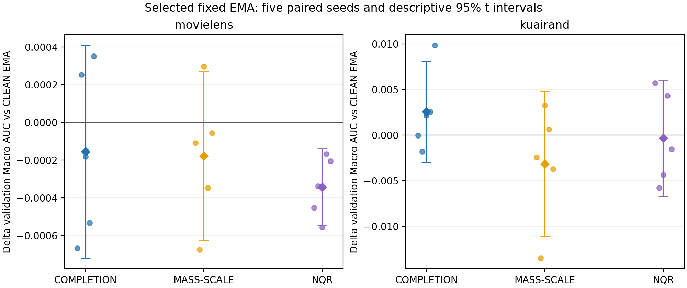
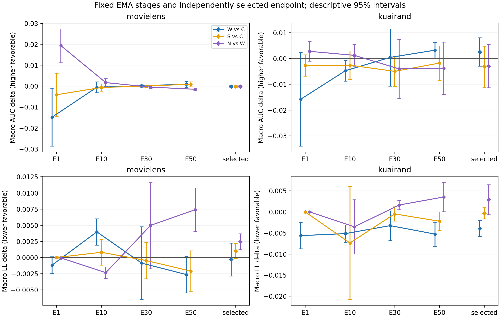
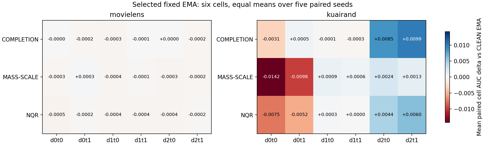

# Cycle04：自然完成权重、全局 BCE 质量与排序项归因

日期：2026-11-17。模型：同源 fixed-fusion M3oE fixed1。数据：自然 MovieLens-1M、KuaiRand。新增 W/S 共20条完整轨迹，精确复用 C/N 数值控制各10条；每条 seeds2022–2026、50epochs。完整定义见 [METHODS](METHODS.md)，全部原数、代码及归档见 [DATA_AVAILABILITY](DATA_AVAILABILITY.md)。

**注册主结论为 MIXED，不满足候选资格。** 去掉排序项的 COMPLETION-BCE-025（W）相对 CLEAN fixed EMA，ML selected Macro AUC 均值−0.000154621，KR +0.002555086；两个五seed描述性区间均跨0。两数据集都未达到+.003的实用目标，KR的d0t0均值−.003141373也未通过−.001的单格保护。KR的Macro LogLoss却在五seed全部改善，均值−.003942334，区间全负。损失收益应保留，但不能替代注册排序门槛。

本轮最有信息量的归因结果是：相同总BCE质量下，W−S的task1损失在两数据集五seed全部降低；添加排序项N−W在ML在线选中AUC及E50排序/损失上存在一致成本，同时它在早期有相反收益。这支持继续区分目标分配和训练阶段，未识别单一class、domain、Adam或EMA中介。

## 实验问题与控制链

记C为不变的两任务平均概率空间BCE；cell c=(domain,task)，w=n/(2B)，π为该cell自然类比例，H=Σπ²·class_mean_BCE，o=2π0π1。固定λ=.25：

`W=.75C+.25ΣwH`；`r=.25Σwo`；`m=1−r`；`S=mC`；`N=W+R`，其中`R=.25Σwo·.5[(1−μ1+μ0)²+var1+var0]`。

W是候选，S=MASS-SCALE-025是新控制，C=CLEAN和N=NQR-025为精确复用控制。W/S都不按m重新归一化，实际总BCE系数质量相同且在[.875,1]。完整50epochs、先每seed取更新均值再等权汇总，ML的m为.894769067451、KR为.899469986269；W与S的五个对应seed数值逐一相同。

W−S同时改变class、cell和task分配。少数类条目的系数通常更低，不能称为类平衡，也不能把该对比解释成class-only效应。S−C在原coupled-weight-decay Adam下改变数据梯度与衰减、epsilon和历史的相对关系，不等价于单纯调学习率。N−W是保留W时添加排序项的完整轨迹效应；缺少S+R，不能估计排序与异质分配的交互。端点差值可代数相加，不代表中介百分比。

自然训练/验证行数分别为ML800167/100021、KR2006132/250767；batch40960，实际tail21927/40052，20/49更新每epoch。沿用源特征、初始化、emb.detach门控、embedding16、原专家/塔结构、Adam lr.01和coupled WD（ML1e−4、KR1e−5）、固定EMA rho（ML.9828205985452511、KR.995）。没有改采样、切分、架构或精度。细节、缺类null语义、精确身份分支及工程证据见方法与正式设计。

Online和fixed EMA分别取E1..50六格验证Macro AUC的最早严格最大值；LL与单格指标使用同一AUC选中状态。统计单位为配对seed，n=5，SD使用ddof1，描述性95%区间为mean±2.7764451051977987·SD/√5。次要对比和多个历史配置共享验证人口，不能把cell、epoch、诊断或复用控制计成新seed。

## 主结果、资格门槛与逐seed数据

以下为独立AUC选中fixed EMA的五seed均值；LL越低越好。C/N的数值来自原控制文件，本轮没有重训它们。

| 数据 | 臂 | Macro AUC | Macro LL | 平均选中epoch |
|---|---|---:|---:|---:|
| ML | C | .759768224 | .524690036 | 22.2 |
| ML | S | .759590273 | .525693332 | 23.2 |
| ML | W | .759613603 | .524384719 | 22.8 |
| ML | N | .759424707 | .526831296 | 20.8 |
| KR | C | .691098041 | .428639572 | 40.4 |
| KR | S | .687954420 | .428318275 | 42.2 |
| KR | W | .693653127 | .424697238 | 42.4 |
| KR | N | .690769307 | .427617542 | 43.0 |

| W EMA−C EMA | ΔAUC均值 | SD | 描述性95%区间 | 正seed | ΔLL均值 | LL降低seed |
|---|---:|---:|---|---:|---:|---:|
| ML | −.000154621 | .000454841 | [−.000719381,+.000410138] | 2/5 | −.000305316 | 3/5 |
| KR | +.002555086 | .004445801 | [−.002965105,+.008075276] | 3/5 | −.003942334 | 5/5 |

ML ΔLL区间[−.002845119,+.002234486]；KR [−.005845996,−.002038672]。ML/KR最小cell平均ΔAUC分别−.000340860/−.003141373。ML通过cell保护但Macro目标未通过；KR两项均未通过。资格判定按注册均值门槛执行，cell区间跨0不撤销该门槛。状态MIXED由一正一负的主AUC均值决定，不升级champion，不打开Test。

| 数据 | seed | ΔAUC W−C | ΔLL W−C | W epoch | C epoch |
|---|---:|---:|---:|---:|---:|
| ML | 2022 | −.000666428 | +.001690013 | 21 | 23 |
| ML | 2023 | +.000253701 | −.001204763 | 25 | 19 |
| ML | 2024 | −.000180268 | +.002062613 | 25 | 20 |
| ML | 2025 | −.000531560 | −.002449277 | 21 | 28 |
| ML | 2026 | +.000351447 | −.001625168 | 22 | 21 |
| KR | 2022 | −.000017013 | −.002938468 | 50 | 44 |
| KR | 2023 | −.001782628 | −.003974475 | 42 | 39 |
| KR | 2024 | +.002141465 | −.004480373 | 50 | 32 |
| KR | 2025 | +.002567028 | −.002157937 | 40 | 50 |
| KR | 2026 | +.009866576 | −.006160420 | 30 | 37 |

KR AUC正均值受2026的大增益明显影响，其余seed范围为−.001783至+.002567；LL改善则跨全部seed。ML排序符号混合，不能把本轮W写成复现了N在ML选中EMA的五seed一致下降。全部400端点、40条轨迹的80条估计器曲线、选点哈希和每格值见 [数值附录](NUMERICAL_APPENDIX.md) 与 [完整配对表](ALL_PAIRED_SEEDS.csv)。

## 控制链：总质量、异质分配与排序

以下仍为selected matched EMA。正/降分别为AUC正seed数及LL降低seed数；括号为描述性95%区间。

| 数据/对比 | ΔAUC均值（区间） | 正 | ΔLL均值（区间） | 降 |
|---|---|---:|---|---:|
| ML S−C | −.000177951 [−.000625940,+.000270037] | 1 | +.001003296 [−.000160191,+.002166783] | 0 |
| ML W−S | +.000023330 [−.000761427,+.000808086] | 2 | −.001308613 [−.004151199,+.001533973] | 3 |
| ML N−W | −.000188895 [−.000744234,+.000366443] | 2 | +.002446577 [+.001217105,+.003676050] | 0 |
| ML N−C | −.000343517 [−.000547122,−.000139912] | 0 | +.002141261 [−.000146061,+.004428583] | 1 |
| KR S−C | −.003143621 [−.011084963,+.004797721] | 2 | −.000321297 [−.001646349,+.001003754] | 3 |
| KR W−S | +.005698707 [−.002396475,+.013793889] | 4 | −.003621037 [−.006636916,−.000605159] | 5 |
| KR N−W | −.002883820 [−.011283315,+.005515675] | 2 | +.002920304 [−.000627021,+.006467629] | 1 |
| KR N−C | −.000328734 [−.006717219,+.006059751] | 2 | −.001022030 [−.004697467,+.002653406] | 3 |

**异质分配的条件损失效应为MEDIUM证据。** KR W−S的Macro LL五seed降低且区间全负；ML Macro LL尚不稳定，但task1 W−S为−.002988932，五seed降低，区间[−.004330420,−.001647445]。KR task1 W−S为−.005124581，五seed降低，区间[−.009497163,−.000751998]。这说明仅用相同全局m不能复制该任务的损失收益；class/cell/task三者仍混在同一干预中。

**排序项的条件成本依赖读出和阶段。** ML N−W online selected AUC为−.000412489，五seed全负，区间[−.000793703,−.000031274]；matched EMA AUC方向不一致、区间跨0，但EMA LL增加五seed一致。KR selected N−W的Macro AUC和LL区间都跨0；task0 Macro AUC为−.002647180、五seed负、区间略低于0。不能把这些局部证据升级为跨数据集普遍排序伤害。

注册的“排序梯度是重复ML selected EMA退化的必要条件”在本轮仍未解决：去掉R后，W−C并未稳定保留那种五seed下降；其区间也未证明等价。局部N−W对比识别的是保留W时添加R的完整训练效应，不是R必要性的完整证明。

全局质量缩放也并非已证实无关。ML S−C task0 LL为+.001563778，五seed增加，区间[+.000900785,+.002226770]，而两数据集主Macro AUC仍不确定。coupled decay、epsilon、批次m变化和Adam历史都是竞争解释；本轮没有单独操纵这些状态。

## 训练阶段与选点、EMA读出

ML W−C EMA AUC在E1为−.014811569（五seed负、区间全负），E10−.000530611、E30+.000173145、E50+.000931472（后面三者区间跨0）。KR对应−.015787506、−.004714963、+.000444205、+.003242111；E10五seed负且区间全负，E50五seed正且区间[+.000243021,+.006241201]。KR E50的排序/损失共同改善是应保留的MEDIUM阶段证据，但不替代selected主判定。

ML N−W在E1的AUC为+.019277577，五seed正、区间全正；E10仍五seed正但区间跨0，同时LL降低−.002348646、五seed一致、区间全负。到E50，AUC变为−.001496855，五seed负、区间[−.002125400,−.000868311]；LL增加+.007416875，五seed一致、区间全正。该反转支持早期优化帮助与后期代价并存，未证明curriculum必然有效。

KR N−W在E30/E50的LL均为五seed增加，区间全正；AUC区间仍跨0。完整E1/E10/E30/E50和所有15族对比见 [ALL_PAIRED_SUMMARY](ALL_PAIRED_SUMMARY.csv)。

ML W EMA−W online选中AUC为+.002717079，五seed正、区间全正；CLEAN自身EMA−online为+.002996449。W EMA−CLEAN online虽有+.002841828、五seed正，matched EMA主增量却为负。KR W EMA−W online为+.001846374，4/5正、区间跨0。EMA读出收益和相对同源EMA的算法增量必须分开；这些端点也没有隔离EMA历史的独立中介效应。

## 任务、域、人口与基线难度

| W EMA−C EMA | task | ΔAUC | ΔLL | LL降低seed |
|---|---:|---:|---:|---:|
| ML | 0 | −.000115953 | +.001935485 | 2/5 |
| ML | 1 | −.000193290 | −.002546118 | 5/5 |
| KR | 0 | +.001728431 | −.002322913 | 5/5 |
| KR | 1 | +.003381740 | −.005561755 | 5/5 |

ML task1 LL区间[−.005078657,−.000013578]；KR两任务LL区间均全负。ML task0 AUC只3/5下降，LL只有3/5增加且区间跨0，较早配置的task0排序/损失联合成本没有在W中稳定重现。

域指标为两任务等权均值，仍按五seed配对。人口和CLEAN基线见 [BASELINE_CELL_CONTEXT](BASELINE_CELL_CONTEXT.csv) / [BASELINE_DOMAIN_CONTEXT](BASELINE_DOMAIN_CONTEXT.csv)。

| 数据/domain | train n | val n | CLEAN EMA AUC | W−C ΔAUC | W−C ΔLL |
|---|---:|---:|---:|---:|---:|
| ML d0 | 155949 | 27111 | .767958341 | −.000131500 | −.000429453 |
| ML d1 | 318599 | 35523 | .756878065 | −.000216650 | +.000154707 |
| ML d2 | 325619 | 37387 | .754468266 | −.000115715 | −.000641203 |
| KR d0 | 172782 | 2692 | .686547442 | −.001311602 | +.002005435 |
| KR d1 | 1743898 | 246232 | .715993098 | −.000224380 | −.006935433 |
| KR d2 | 89452 | 1843 | .670753584 | +.009201240 | −.006897004 |

KR最小d2的AUC五seed增加，区间[+.000712515,+.017689965]，LL五seed降低；另一个较小域d0的LL五seed增加、区间[+.001099812,+.002911058]，AUC方向混合。最大d1的AUC区间跨0、LL五seed改善。这既保留局部小域排序收益，也否定把全部结果概括为统一“小域收益/大域代价”的充分依据。ML三个域AUC均值都略负，最小域的基线AUC反而最高，没有跨数据集一致的规模排序。

KR的保护失败具体来自d0t0：ΔAUC−.003141373，2/5正、区间跨0；LL增加+.003516781，五seed一致、区间全正。d0t1 AUC+.000518168、LL+.000494088；d1t0/t1 AUC−.000144883/−.000303878，而LL分别−.004995066/−.008875801且五seed降低。d2t0 AUC+.008471549、五seed正、区间全正；d2t1 +.009930931、4/5正、区间跨0。两格LL均五seed降低。ML最小cell均值为d1t0−.000340860，六格均满足注册均值保护；逐格seed及区间在完整配对表。

训练规模、验证规模、类先验与基线表现没有被独立操纵。KR d0/d1/d2训练task0正比例约.0909/.3778/.6169，task1约.0412/.2561/.4848；d1验证task0正比例约.2097。验证人口又高度集中于d1。CLEAN域AUC的seed SD分别约.01156/.00106/.00404。基线低AUC、低LL或小样本数各有不同统计含义，不能直接当成同一种“困难度”。因此规模作为主要因果解释仍为WEAK。

KR W−C的sample-weighted cell AUC为−.000166779（仅1/5正、区间跨0），task-pooled AUC均值+.000004440（1/5正、区间跨0），与等权Macro AUC正均值不同。pooled LL为−.006839170，五seed降低、区间全负，主要人口所在d1也有损失收益。LL的pooled与按cell样本数加权是同一逐样本损失的等价汇总，不能当成独立重复；不同AUC汇总也不能相互替代。

## 同状态诊断能说明什么

80个已提交诊断点使用普通batch的同一forward、额外240次autograd sweeps、320次顺序disposable source-Adam step。每点actual-arm virtual/live更新精确一致，未增加forward、live EMA或算法RNG。参数活动保留None/tensor-zero差别，缺失cosine保留null原因。

在W host、ALL参数组，ML E1的W−S梯度cosine为.998448913，Adam update cosine为.981398739；KR为.998784828/.993259031。E50分别变为ML .857122252/.997247059、KR .846614934/.967331511。N−W E1梯度cosine接近1（ML .999999155、KR .999999394），update cosine却为.992984576/.999332466；E50的梯度cosine为.982133661/.977703361。这些是目标改变和实际优化器响应都可观测、且随host状态/阶段变化的局部证据。

不同epoch/host还改变了参数、Adam历史和自然batch。局部角度或norm不能解释完整训练效应的百分比，也不能由“接近1”推出R无效。`deltaEMA=(1-rho)*deltaTheta`及其algebraic标记只是代数关系，没有执行额外live EMA；已保存为4160条 [DIAGNOSTIC_ANNOTATIONS](DIAGNOSTIC_ANNOTATIONS.csv)，17888条 [DIAGNOSTIC_MEANS](DIAGNOSTIC_MEANS.csv)仅汇总数值与显式null。

## 稳定现象、反例与证据强度

| 判断 | 强度 | 适用范围 |
|---|---|---|
| W/S的相同batch总质量、源身份/完整预算和已观测资格门槛判定 | STRONG | 数学、实测执行和固定验证人口上的算术判定 |
| KR W−C、W−S的Macro LL改善，以及两数据集W−S task1 LL改善 | MEDIUM | 本模型、自然切分、五seed、独立AUC选中状态 |
| ML排序项早期帮助、E50排序和损失成本，online selected N−W排序下降 | MEDIUM | 保留W时添加R；读出/阶段必须明确 |
| W带来稳定跨数据集selected AUC增量 | WEAK／未建立 | 主符号混合，KR seed偏斜，两主区间跨0 |
| 排序项是所有持久选中退化的必要原因，或单一Adam/EMA中介已识别 | WEAK／未解决 | 缺少必要的独立状态/交互干预 |
| domain size是主因，或存在统一小域收益/大域下降交换 | WEAK／未建立 | 两较小KR域方向不同，最大域LL改善，人口/先验/身份混杂 |

不能丢掉的反例包括：本轮KR E50五seed排序改善、d2 selected AUC五seed改善、最大d1 LL五seed改善；本轮ML task1 LL改善与task0不确定并存。历史TV γ=.20在ML的+.000154（3/5正、区间跨0）、C1 KR IID2的+.001270（2/5正、区间跨0）、C3 KR LATE的+.000738（2正3零、区间跨0）也仍为WEAK条件信号，不支持“所有干预都全负”。

C2 N−C数值在本轮复用，C3 EARLY的E10又与C2 prefix完全相同，均不能计作新独立重复。C3 EARLY相对constant N在ML选中LL五seed改善，却未恢复AUC；本轮W进一步把排序和权重分开，仍不能据此假设curriculum、动量有效或M3oE必然在困难域失败。

## 竞争解释与最有区分力的后续问题

解释一是自然class/cell/task完成权重改变了有效风险与任务分配，支持来自相同m下的task1损失收益；当前对比不能判断它来自class内权重还是cell/task间质量。解释二是R有早期优化收益，但持续暴露与后期拟合/优化器路径共同产生代价，支持来自ML N−W的阶段反转。解释三是m与coupled Adam/decay/history的相互作用，S−C的部分任务损失成本使其不能被排除。验证人口、类先验和选点规则也能解释跨汇总、跨阶段差异，当前没有独立识别它们。

最有区分力的下一问题是：**持续保留W时，能否通过只改变R的暴露阶段，区分早期历史印记和持续后期排序力？** C3在关闭N时回到C，同时关闭了完成权重和排序；本轮给出了保留W的理由与可复用控制。相同总暴露但不同阶段、完整50epoch和同一选点规则的比较，若仍不能恢复主增量，将削弱“仅持续晚期R导致失败”的解释。另一关键候选是保留W的cell/task总质量但取消class内异质权重，或补齐S+R交互；新的Astra研究智能体须比较这些不同机制后选择正式设计，不能把本段当作已批准的额外运行或预设正效应。

## 完整执行、恢复与成本

当前有效attempt2完成1000epochs、34500次ordinary forward/scalar backward/live Adam/live EMA、1403149500训练行和2806299000任务条目；10000个验证chunk。父编排器于2026-11-17T11:21:33.883200+00:00直接验收40个选中模型哈希、选中epoch和验证值，当时20个状态共191017920B位于owner2476891/session67406。证据审查于12:02:24发现该owner已不存在，父级复查及会话退出码143确认当前选中模型不可用；退出时间和触发原因未确定。历史验收、完整数值和MIXED结论仍有效，当前不能基于这些模型续训或评估Test。没有磁盘模型/优化器/RNG/checkpoint文件；Test未访问。处置记录见[选中RAM可用性更新](../../artifacts/26-11-16_augmentation_gradient_momentum/astra_cycles/cycle_04/SELECTED_RAM_AVAILABILITY_UPDATE.json)。

attempt2共有30个物理worker：20 COMPLETE、8 PAUSED、2失败仅由supervisor观测。1009个可完整读取batch文件保留34640次返回调用，比有效提交多140次；物理返回诊断81点、243 sweeps、324 virtual steps，与有效80/240/320分开。已返回调用耗时61546.47s，已知worker耗时60790.56s但缺两份失败terminal duration，supervisor process-wall合计68156.82s；三段控制器运行时段合计14179.96s。这些量相互重叠、覆盖范围不同，不能相加，也不能把缺失项记零。详见 [RESOURCE_EXECUTION_AUDIT](RESOURCE_EXECUTION_AUDIT.json)、[PHYSICAL_BATCH_LEDGER](PHYSICAL_BATCH_LEDGER.csv)、[COST_MEANS](COST_MEANS.csv)。

两次NVML code3暂停分别发生于771和889epochs。最后一次恢复补完111epochs/2249调用，无新增失败。旧attempt1因RAM状态丢失被退役，其275 ACK epochs/7733updates不给attempt2完成信用；其40个物理进程、已知10523.26s worker时间及一份缺失terminal另计，见 [RETIRED_ATTEMPT_COSTS](RETIRED_ATTEMPT_COSTS.json)。旧恢复的stale allocated绑定问题经新设计、实现、独立审查和四个真实GPU工程case后修复。当前工程32次调用/8诊断/24sweeps/32virtual steps不进入正式科学预算。

NVML失败的具体API仍未记录，成功复查不能定位原因。失败cleanup又中断了terminal成本写入，原始未知字段保持未知。原runner报告把recovery02的commit/status/get耗时误读为0；111条ACK对应真实合计61.909074s，字段更正见 [COST_ACCOUNTING_CORRECTION](COST_ACCOUNTING_CORRECTION.json)，原归档收据保持原样。完整过程见 [EXECUTION_HISTORY](EXECUTION_HISTORY.md)。

有效attempt2的父监督记录中最多观察到5个实际CUDA worker；recovery02启动形成GPU0两/GPU1三个。逐卡使用当时整卡显存和功耗<85%、hostRAM<90%，加实测完整进程包络在CUDA可用100%容量内可容纳的条件；每次新PID/registration-attempt的完整分配ACK后重新采样，没有固定worker cap。其他GPU作业持续存在，因此墙钟不能作为隔离后的算法效率比较。

完整数值归档740197954B，89分片，6611成员、未压缩4077601426B，覆盖新attempt2、旧attempt1及1020个精确控制文件。准入日志和资源审计占据大量重复记录；后续工程应保留每次实际决策和原始资源观测，以已有profile的可重算引用记录包络见证，避免每次复制完整历史profile列表。这是已测存储/交付负担，不能通过少记决策或降低准入条件处理。

本轮完整报告、研究上下文和证据审查实际发布后，进入用户授权的唯一追加Cycle05。Cycle05完成实验、报告和交付后终止；不启动Cycle06。
