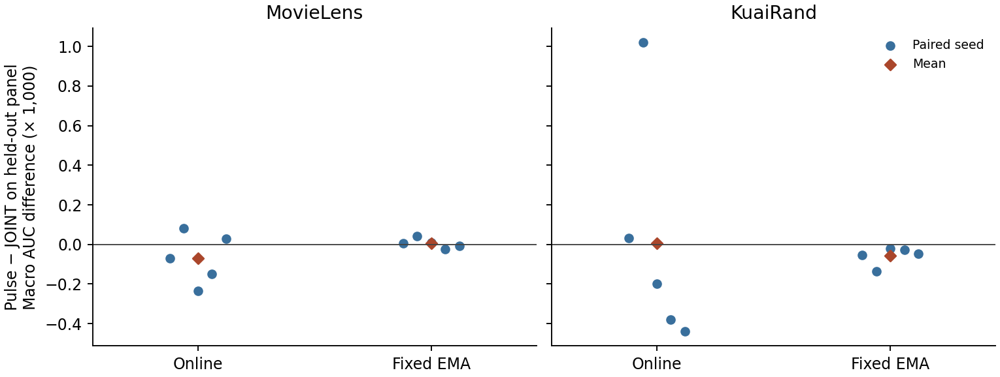

# B 方向：共享更新的一步干预与脉冲

在 10 条 clean 重放的 40 个真实锚点上，完整联合更新的虚拟 Adam 与实际 Adam 哈希一致。两数据集均观察到去掉某个真实源的共享更新后，其他域任务格的排序改善。两数据集的训练面板选源脉冲均未通过持续策略的准入门，B_ADAPT、B_STATIC、B_UNIFORM 与 A+B 因此未触发。

重放的 60 个 Validation 端点（两种读出 × E10、E50、selected × 10 条轨迹）与历史 A00 全部逐项匹配模型哈希和 epoch，Macro AUC 最大绝对差为零。[重放身份表](../../artifacts/conditional_history_shared_update_20261122/tables/B_CORE/CLEAN_REPLAY_IDENTITY.csv)

每数据集五种子。锚点取 E5、E20、E35、E50 的最后一批；在 E20/E35 进行脉冲，真实源与预注册伪源各占一个槽位。两个 epoch 先在种子内取均值，NO_ACTION 留在分母内。下表为留出面板 V_B 的配对 Macro ΔAUC。

| 数据集 | 读出 | 脉冲 − JOINT | 正向种子 | 配对 95% 区间 | 真源脉冲 − 伪源脉冲 |
|---|---|---:|---:|---|---:|
| movielens | online | -0.0000690 | 2/5 | [-0.0002278, +0.0000897] | +0.0000246 |
| movielens | fixed_ema | +0.0000049 | 3/5 | [-0.0000252, +0.0000351] | -0.0000013 |
| kuairand | online | +0.0000063 | 2/5 | [-0.0007326, +0.0007452] | -0.0000562 |
| kuairand | fixed_ema | -0.0000565 | 0/5 | [-0.0001144, +0.0000013] | -0.0000393 |

**MEDIUM · 训练面板的选源规则。** 留一 seed 的静态对照仅用其他种子的早期锚点选源。在晚期留出锚点上，动态选源相对静态的平均 Macro ΔAUC，MovieLens 为 −0.0000362（0/5 正），KuaiRand 为 −0.0000134（2/5 正）。KuaiRand 的 online 脉冲略优于 JOINT，却低于匹配伪源；固定 EMA 读出的方向还转负。MovieLens 的 online 脉冲低于 JOINT。两组结果都未显示足够的训练期选源信息来部署持续控制器。

**WEAK · 一步效应的跨域解释。** 对留出 V_B 上的真实源按四个锚点、五种子平均，共享 EMBED 对自身格 / 其他格的 AUC 贡献在 MovieLens 为 +0.000140 / +0.000027，在 KuaiRand 为 +0.000061 / +0.000005。均值与局部格的损害可以并存。作为非全局共享坐标对照，N 范围内 KuaiRand 的源对自身格 AUC 贡献约 +0.000042，对其他格均值约 −0.000009；MovieLens 分别约 −0.000003 和 −0.000002。局部损害、同尺度干预、固定 EMA 背景和持续训练分别回答不同问题。脉冲比较提示普通更新的尺度、训练噪声和读出平滑均是竞争解释；此版未获得开展持续控制训练的证据。

完整分组比较保留在 [B 核心数表目录](../../artifacts/conditional_history_shared_update_20261122/tables/B_CORE/)。其中 B0_EFFECTS 含六格 AUC、固定样本对、LogLoss、同尺度与伪分组对照；B1_EMA_INTERACTIONS 分列实际 EMA、小步和同方向读出；B_GATE 保存全部五种子的脉冲效应、区间和阶段决定。

