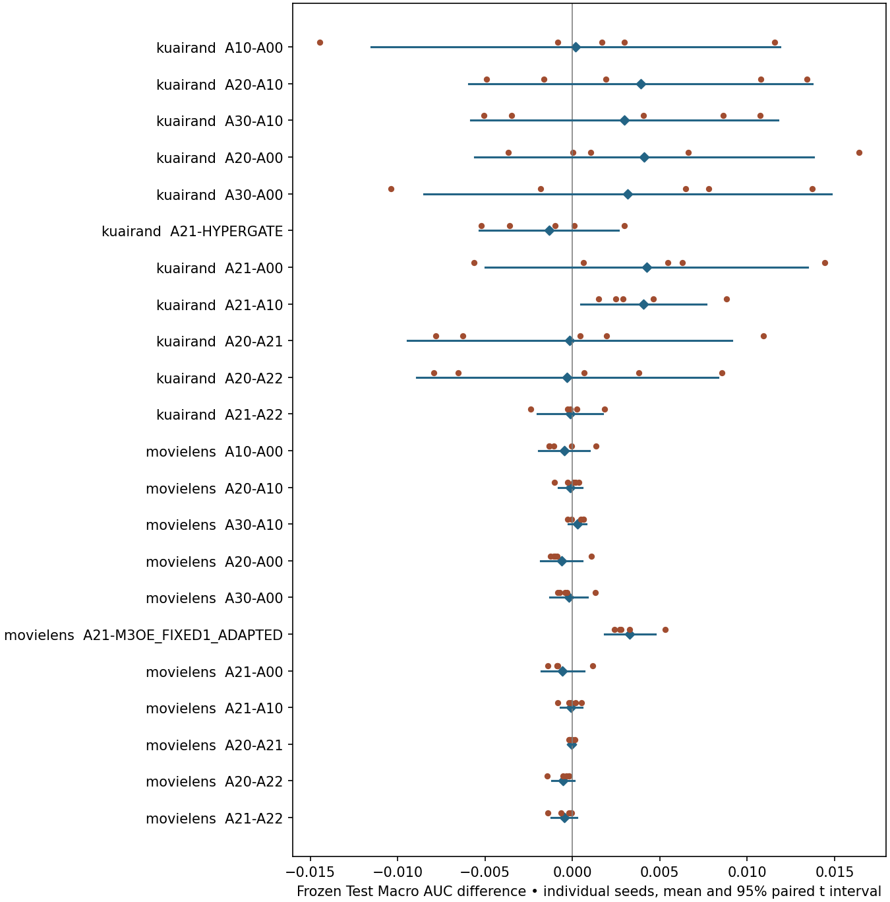

# 条件历史与共享更新：五种子实验报告

**A21 未达到预注册的最终算法资格。** 在目标数据集 MovieLens 上，A21 比已发表 M3oE 的 Test Macro AUC 高 0.003284，但比同主干的 clean + 固定 EMA 低 0.000564，也未超过使用相同 PAIR 监督的普通 Adam。在 KuaiRand 上，A21 相对同 PAIR 的普通 Adam 有五种子一致的 Test 增量，但弱于已发表 HyperGate，且最大域的两个任务均低于 clean + EMA。B 方向检出了真实一步更新中的跨格损害，动态选源未转化为足以部署的持续训练信号。

## 最终 Test 对照

A21 在自然样本对上使用一份汇总辅助历史。比较单位为同 seed、同人口的配对差。表中 Δ 为 A21 减对照，AUC 越高越好，LogLoss 越低越好。区间为五种子配对均值的 95% t 区间。保护线对每个格的五种子平均 ΔAUC 为 −0.001。

| 数据集 | 对照 | ΔMacro AUC | 95% 区间 | 正向种子 | ΔMacro LogLoss | 最差格 ΔAUC |
|---|---|---:|---|---:|---:|---|
| movielens | 已发表 M3oE | +0.003284 | [+0.001842, +0.004726] | 5/5 | -0.000400 | d2t1 +0.002577 |
| movielens | clean + EMA | -0.000564 | [-0.001801, +0.000672] | 1/5 | -0.001649 | d0t1 -0.001040 |
| movielens | 相同 PAIR + Adam + EMA | -0.000083 | [-0.000705, +0.000540] | 2/5 | -0.001079 | d2t1 -0.000337 |
| kuairand | 已发表 HyperGate | -0.001347 | [-0.005323, +0.002630] | 2/5 | -0.005250 | d0t0 -0.014493 |
| kuairand | clean + EMA | +0.004243 | [-0.004975, +0.013461] | 4/5 | -0.000607 | d1t0 -0.003728 |
| kuairand | 相同 PAIR + Adam + EMA | +0.004062 | [+0.000469, +0.007656] | 5/5 | +0.000070 | d1t1 -0.001113 |

MovieLens 的发表基线对比通过 +0.003 总增量，但内部强对照的 d0t1 比保护下限再低 0.000040，阶段判定为 MACRO_GAIN_WITH_CELL_TRADEOFF。KuaiRand 的发表基线对比低于 +0.002 总门且 d0t0 下滑 0.014493，判定为 BELOW_TOTAL_THRESHOLD。协议还要求相对强内部对照和匹配组件有独立增益。

[全部模型的 Validation/Test 绝对均值和标准差](../../artifacts/conditional_history_shared_update_20261122/S5/main_table.csv) · [逐 seed 六格、域、任务、pooled 与支持数](../../artifacts/conditional_history_shared_update_20261122/S5/endpoints.csv) · [配对差与区间](../../artifacts/conditional_history_shared_update_20261122/S5/paired_summary.csv) · [逐种子配对](../../artifacts/conditional_history_shared_update_20261122/S5/paired_seed.csv) · [六格保护图](../../artifacts/conditional_history_shared_update_20261122/S5/paired_test_cell_auc.png)

## 哪一部分产生了增量

**STRONG · 固定 Test 人口内的两个配对结果。** MovieLens 的 A21 相对已发表 M3oE 五个种子均提升；KuaiRand 的 A21 相对同 PAIR 普通 Adam 五个种子均提升。前者含固定 EMA 等完整方案收益，后者的参考臂已匹配 PAIR、优化预算和 EMA。两项结论适用的对照和数据集不同。

**WEAK · 条件历史跨数据集稳定有效。** 相对普通 Adam，24 条条件历史 A20 在 Validation 的均值增量分别仅 +0.000161 和 +0.000172。与其做同监督比较时，单份辅助历史 A21 在 MovieLens 的 Validation 排名和六格保护足以按预注册简化带选中；KuaiRand 当地首选 A20。冻结后的 A21 相对同 PAIR Adam，在 MovieLens 出现 Validation 正、Test 负，在 KuaiRand 出现 Validation 负、Test 正。背景、选点和样本人口都影响了归因。低剂量 λ=0.025 在两数据集相对同剂量 Adam 的验证增量都为负。完整因子表与选点见 [A 核心报告](A_CORE_REPORT.md)、[简单历史报告](A_HISTORY_REPORT.md)、[成对剂量与定位报告](A_DOSE_REPORT.md)。

**MEDIUM · 当前跨格选源规则缺少可部署收益。** 40 个真实 Adam 锚点均通过虚拟联合更新与实际更新的身份核验。KuaiRand 上，online 短段脉冲相对 JOINT 平均 +0.0000063，相对等预算伪源却为 −0.0000562；MovieLens 上相对 JOINT 为 −0.0000690。两数据集晚期留出面板的动态选源均值都低于留一 seed 的固定源。真实源、伪源、等尺度干预、固定 EMA 和 NO_ACTION 一起保留在 [B 机制报告](B_CORE_REPORT.md)。

## 域规模、任务与训练阶段

MovieLens 的 D0/D1/D2 训练行数为 155,949 / 318,599 / 325,619，clean + EMA 验证域均 AUC 为 0.767988 / 0.756619 / 0.753927。最小域的基线排序最好。KuaiRand 的对应行数为 172,782 / 1,743,898 / 89,452，基线 AUC 为 0.677939 / 0.717428 / 0.669996；最大域的基线排序最好。这里的困难度以冻结基线的同人口表现描述。

A21 相对 clean + EMA 的 KuaiRand Test 域均 ΔAUC 为 +0.014855 / −0.003537 / +0.001410，小域获益、最大域受损；按任务均值看，两任务却分别为 +0.002024、+0.006461。MovieLens 三域 ΔAUC 均为负，两个任务分别为 −0.000540 和 −0.000589。域规模对 KuaiRand 的这一对照有描述力，跨数据集证据为 WEAK。相对同 PAIR Adam，KuaiRand 的验证 Macro ΔAUC 从 E10 的 +0.002022 变为 E50 的 −0.005104；MovieLens 同期为 +0.000492、+0.000285。模型固定为 M3oE fixed1，当前结果不足以推出主干无关的机制。

**最能区分竞争解释的后续实验**是在独立未暴露的 KuaiRand 时间窗口上，预先冻结 A21、A10、A00 及同一验证选点规则，同时复核 d1t0/d1t1 和 Macro。它能区分历史通道的可迁移增益与当前划分、选点及域组成的交互。本轮的阶段选择和最终结论均已冻结。

## 执行、冻结与成本

使用原 CSV 自然 80/10/10 划分和仅训练集拟合的预处理，两数据集各三域两任务。种子 2022–2026；每轨迹 50 epoch、batch 40,960、FP32，保留自然尾批。A21 λ=0.05、静态 PAIR、S_DENSE 与固定 EMA 均在看本轮 Test 前冻结。两数据使用同一形式。Test 属于已有历史人口。

| 阶段 | 实际工作 | 结论或用途 |
|---|---:|---|
| A_CORE | 12 条新训练，另复用 28 条历史训练 | 补齐 P00/P10 缺失的三个种子 |
| A_HISTORY / A_DOSE | 20 + 20 条新训练 | 完成简单历史及匹配剂量对照 |
| B_CORE | 10 条 clean 重放、40 个锚点、2,080 次虚拟 Adam、720 次来源梯度计算 | 60 个可比 Validation 端点与历史模型哈希、epoch、Macro AUC 全部吻合 |
| B_PULSE | 40 个槽位、7 个 NO_ACTION、1,120 个实际后续反事实 Adam 步 | 两数据集均关闭 B_SEARCH，AB 未触发 |
| A_TARGET | 原 RAM 状态的 80 个锚点、320 条门控记录、19,200 次面板前向 | 未触发两种作用域限制 |
| S5 | 90 个端点，58 个已登记历史数值，32 个新 Test 评价 | 每个数据集五种子；方法与比较均在评价前冻结 |

总计 52 条新科学轨迹与 10 条状态重放，共 3,100 个物理训练 epoch 和 106,950 个主训练 Adam/EMA 更新。所有正式训练均在首个 attempt 完成。A_CORE、A_HISTORY、A_DOSE、B_CORE 的 worker 时间和分别为 2.364、6.852、6.053、2.389 小时；并行 worker 时间不可相加解释为双卡墙钟。从本阶段首个准入时间到监督器完成收据，四个完整训练阶段的墙钟分别为 19.6、37.5、42.9、21.1 分钟。成本表覆盖已计量的正式训练、重放、脉冲与定位；首批工程检查和 Gaussian 源码身份审计的总耗时未单列。训练中保留的权重和优化器状态存于 RAM。工程校验收录实际首批/尾批、当前状态读回、完整进程显存及逐卡准入。

**Gaussian 补充表技术暂停。** 既有五种子 D0 控制使用按 batch 抽样的 GA31-R3 噪声，11-22 要求 EMA02 按样本行键生成噪声。两数据 × 五种子的首批核验全部不符。MovieLens 可精确复用两个种子，KuaiRand 缺少同身份 D0 对照。按手册暂停此表，未派发 10 条补充训练；该分支没有性能结论。[源码身份独立审查](G_CONTROL_REVIEW.md)

[实际成本明细](../../artifacts/conditional_history_shared_update_20261122/physical_costs.csv) · [最终评价成本](../../artifacts/conditional_history_shared_update_20261122/S5/costs.csv) · [最终冻结记录](../../artifacts/conditional_history_shared_update_20261122/FINAL_FREEZE.json) · [逐端点收据索引](../../artifacts/conditional_history_shared_update_20261122/S5/EVALUATED.json) · [最终判定](../../artifacts/conditional_history_shared_update_20261122/S5/S5_REPORT.json) · [运行手册](../../research_plans/26-11-22_conditional_history_shared_update/00_EXECUTION_RUNBOOK.md)

### 实际执行入口

项目解释器为 `/home_new/xzf/envs/miniconda3/envs/phase0-3-env/bin/python`。以下为本次已执行模块，统一前缀为 `experiments.conditional_history_shared_update_20261122.`，各模块以 `python -m` 调用。

| 工作 | 模块及动作 |
|---|---|
| A_CORE、B_CORE | `cli audit/check/run/analyze --stage A_CORE` 或 `B_CORE`，每个动作单独调用 |
| B_PULSE | `b_stage pulse` |
| A_HISTORY | `history_stage audit/check/run/analyze` |
| A_DOSE | `dose_stage audit/check/run/analyze`，定位完成后 `dose_stage analyze --localization` |
| A_TARGET | `a_localization_stage run --arm A21`、`run --arm A40_HISTORY_L025`、`combine` |
| Gaussian 控制身份 | `gaussian_control_audit` |
| 最终冻结与评价 | `final_evaluation freeze`、`evaluate --device cuda:0`、`report` |

本仓库中的数表、冻结记录和收据足以复核报告数值。训练状态由当时的 RAM guardian 保存；部署在另一机器时需要从冻结配置重建所需模型。归档记录的绝对路径对应原运行机。运行内核、原始 CSV 和历史 Git 对象的身份见 [S0 清单](../../artifacts/conditional_history_shared_update_20261122/A_CORE_SOURCE_MANIFEST.json)。
