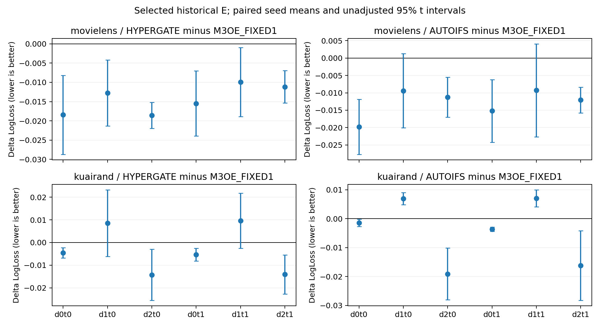

# MDMT 2025–2026 基线实验：五种子结果与证据分析

2026-10-29，协议 `MDMT-SOTA-2526-v1`。已完成 8 条开发轨迹、30 条正式训练和 60 个历史 E 检查点评估视图。正式种子均为 2022–2026；每个模型、数据集各有五个种子。没有缺失种子、替换种子或依据 E 重新选择检查点。

两种新基线均已接入并完成真实训练。MovieLens 上，两者相对 M3OE_FIXED1 的 macro AUC 与 macro LogLoss 改善在五个种子中一致；KuaiRand 上，AUC、macro LogLoss 与 natural LogLoss 给出了不同结论，不能概括为全面优于基线。

**这些结果属于官方核心模型的统一协议适配及历史 E 再评估。** HyperGate 的部分超参数仍为已登记的 `UNVERIFIED_PROPOSAL`；E 不是首次接触的独立确认集。不得将本表标为原论文数值的严格复现。

## 实现、协议与验收

- HyperGate 固定使用主仓库 `fdc82e3f3feee23694a8123f91092615f977900e` 及其 RecStudio gitlink `f08cca607e998e8be4c5e915a393346baffa71f6`。保留 embedding/SENet、专家偏置、任务/域融合三类门控、增强网络、锚点、detach 位置、辅助损失和官方 Xavier 初始化。完整论文配置未能核实，不能把当前登记参数称为作者原配置。
- AutoIFS 使用外部固定源码 `65fc27cdfad1eb6d7a4a2cc69cd31f61cc8e3d7e`。保留共享网络、LoRA、选择器、10 轮 search、进入零基 epoch9 前的 rewind、最终 selector/门控 embedding 移植、hard-ticket 和 reuse。四处 bias 的输出维度错误作了已记录的机械修正。MovieLens 的连续 age 接口、当前 KuaiRand 的 33 个非域字段、V-only 模型选择替代原 test 调用，均为明确适配；没有把原 89-field TFRecord 与本数据视为相同输入。
- 比较器明确为 **M3OE_FIXED1**：固定融合系数1，不含学习融合或 DARTS。不能将结果泛称为所有 M3oE 版本的性能。
- 所有模型训练只使用 T0∪F，编码器/缩放器只在 T0 拟合；V macro LogLoss 选择检查点，Q 仅用于开发，S/legacy 不参与。数据、标签、域/任务、评价公式和正式种子一致；优化器、batch、辅助目标和训练阶段保留模型自身协议，没有强制等预算。
- 先完成全部正式训练并通过完整冻结，再读取 E。冻结保留了实际 R1/R2 两个源码快照及逐运行绑定，数量分别为20/10，没有将它们伪称同一份源码。R2 的特征存储调整经过完整特征值、RNG、模型更新及精确轨迹对照，模型/损失/采样算法保持原样。

设计、实现与独立审查均已完成；初始模型/协议21项检查通过，运行 I/O 修订相关16项独立检查通过。后续外部诊断和收尾工具的导入、schema、快照一致性及原子提交问题均在执行前修正并复审通过，FAIL 历史保留。详见 [源码审计](SOURCE_AUDIT.md)、[设计](DESIGN_SPECIFICATION.md)、[实现报告](IMPLEMENTATION_REPORT.md)、[初始审查](REVIEW_REPORT.md) 及各运行修订审查记录。

## 主结果：V 选择的 selected checkpoint

均值 ± 样本标准差，n=5。Macro 指六个 domain-task cell 的等权平均；natural LogLoss 按有效标签请求数加权。Natural AUC 是 cell AUC 的请求数加权平均，**不是 pooled AUC**；跨域 pooled AUC 按任务分别记录在机器表中。

| 数据集 | 模型 | Macro AUC ↑ | Macro LogLoss ↓ | Natural AUC ↑ | Natural LogLoss ↓ |
|---|---|---:|---:|---:|---:|
| MovieLens | M3OE_FIXED1 | 0.759446 ± 0.000797 | 0.512138 ± 0.002874 | 0.760736 ± 0.000710 | 0.510035 ± 0.003116 |
| MovieLens | HyperGate | 0.766825 ± 0.001084 | 0.497752 ± 0.002281 | 0.768132 ± 0.000961 | 0.496053 ± 0.002113 |
| MovieLens | AutoIFS | 0.762996 ± 0.001291 | 0.499307 ± 0.002649 | 0.764383 ± 0.001207 | 0.497721 ± 0.002736 |
| KuaiRand | M3OE_FIXED1 | 0.668607 ± 0.004612 | 0.436616 ± 0.002798 | 0.701203 ± 0.001037 | 0.417867 ± 0.006184 |
| KuaiRand | HyperGate | 0.683018 ± 0.004696 | 0.433282 ± 0.002756 | 0.706206 ± 0.003814 | 0.426621 ± 0.004994 |
| KuaiRand | AutoIFS | 0.675915 ± 0.002285 | 0.432216 ± 0.001898 | 0.709472 ± 0.000560 | 0.424544 ± 0.004920 |

同种子差值定义为“候选模型 − M3OE_FIXED1”。下表区间为 n=5、df=4 的描述性配对95% t区间，未做多重比较校正；它描述固定划分上的训练随机性，不覆盖重新抽取测试集的不确定性。六个 cell、两个 checkpoint 视图均不增加独立重复数。

| 数据集 / 候选 | ΔMacro AUC [95%区间] | AUC改善种子 | ΔMacro LL [95%区间] | LL改善种子 |
|---|---:|---:|---:|---:|
| MovieLens / HyperGate | +0.007379 [0.006348, 0.008411] | 5/5 | −0.014386 [−0.017470, −0.011302] | 5/5 |
| MovieLens / AutoIFS | +0.003551 [0.001736, 0.005365] | 5/5 | −0.012832 [−0.018571, −0.007093] | 5/5 |
| KuaiRand / HyperGate | +0.014412 [0.005235, 0.023588] | 5/5 | −0.003334 [−0.008988, 0.002319] | 3/5 |
| KuaiRand / AutoIFS | +0.007308 [0.001919, 0.012698] | 5/5 | −0.004400 [−0.007942, −0.000859] | 5/5 |

**STRONG，限本协议和固定 E：** 两个模型在两个数据集的 macro AUC 都在5/5种子改善；MovieLens 的两项 macro 指标也均为5/5改善。HyperGate 的 MovieLens 六格 AUC/LL 全部逐种子改善，但不能将这一结论推广给所有模型或域。

**MEDIUM：** KuaiRand HyperGate 的 macro LL 均值降低，但仅3/5种子改善，区间跨0。不能称其 LL 收益稳定。其 natural LL 均值反而增加0.008754，4/5种子变差，但区间跨0，证据也弱于稳定方向的结果。

**STRONG，限本设置：** KuaiRand AutoIFS 的 macro LL 降低，而 natural LL 增加0.006677，五个种子全部变差，配对区间[0.004585, 0.008768]。其 natural AUC 同时提高0.008269，五个种子一致。因此“排序改善”和“按真实样本权重的概率损失改善”不能互相替代。

2024–2026 未用于本轮开发的三个种子中，四组候选比较的 macro AUC 与 macro LL 均为3/3改善；这说明总体收益不是只由本轮开发见过的2022/2023推动，但不代表这些种子或 E 在整个研究历史中从未使用。

## 域大小、难度与取舍

MovieLens 域0/1/2对应年龄{1,18}/{25}/{35,45,50,56}；任务0/1为 rating>3/rating>4，并非真实观测点击。KuaiRand 域0/1/2对应 tab0/1/4；任务为 is_click/long_view，后者未与 click 相乘。

下表将两个任务等权平均。完整逐任务绝对指标、同种子差值、区间和方向计数见 [CELL_COMPARISONS.csv](analysis/CELL_COMPARISONS.csv)。

| 数据集 / 域 | 训练行数 T0∪F | E行数 | 基线AUC | HyperGate ΔAUC / ΔLL | AutoIFS ΔAUC / ΔLL |
|---|---:|---:|---:|---:|---:|
| MovieLens d0 | 134,116 | 27,687 | 0.763166 | +0.007994 / −0.016961 | +0.003965 / −0.017496 |
| MovieLens d1 | 273,995 | 41,434 | 0.772834 | +0.007731 / −0.011335 | +0.004587 / −0.009340 |
| MovieLens d2 | 280,032 | 30,900 | 0.742337 | +0.006412 / −0.014863 | +0.002100 / −0.011659 |
| KuaiRand d0 | 148,591 | 2,613 | 0.647065 | +0.027165 / −0.004916 | −0.002142 / −0.002525 |
| KuaiRand d1 | 1,499,752 | 246,284 | 0.702116 | +0.004720 / +0.009073 | +0.008322 / +0.006959 |
| KuaiRand d2 | 76,928 | 1,870 | 0.656639 | +0.011351 / −0.014159 | +0.015744 / −0.017635 |

**STRONG，观察性取舍：** KuaiRand 的两个较小域 LL 均值下降，最大域 d1 的 LL 均值上升。AutoIFS 对 d1 两任务都在5/5种子变差，对 d0/d2 两任务都在5/5改善；HyperGate 的小域两任务均5/5改善，最大域两任务均4/5变差。这是明确的“小域 LL 改善 / 大域 LL 下降”现象。

这一取舍不适用于所有指标：KuaiRand 最大域 d1 的 AutoIFS 两任务 AUC 均5/5提高，HyperGate 的六格 AUC 均值都提高。MovieLens 也没有大域 LL 普遍下降。因此不能把它概括为大小域性能必然零和。

**域大小不是域难度的定义。** MovieLens 最大训练域 d2 的基线 AUC 最低，最小域 d0 并非最难；KuaiRand 最小域 d2 的基线 AUC 又高于较大的 d0。AutoIFS 在 KuaiRand d0/task0 的 AUC 有4/5种子下降（均值−0.009195，区间跨0），但在更小的 d2 两任务均5/5上升。样本量无法单独解释这些差异。

训练域大小是否是主要因果变量：**WEAK，尚未识别。** 每个数据集仅三个物理域，域身份、特征分布、正例率、训练量和测试支持数相互混杂；基线 AUC 只能作为当前模型的操作性难度参照，不能代表固有或 Bayes 难度。

相比之下，**测试域权重对 macro/natural 分歧的解释为 STRONG，属于算术分解**。KuaiRand d1 占训练86.93%，却占 E 的98.21%；macro给每域1/3权重。AutoIFS 的 natural LL 差值约为：

`0.98212 × 0.006959 + 0.01042 × (−0.002525) + 0.00746 × (−0.017635) = +0.006677`。

这解释了为什么 macro LL 降低而 natural LL 上升；它并不证明“大训练域的样本量导致了伤害”。KuaiRand d1 的 click 正例率从训练37.80%降至 E21.05%，long_view 从25.62%降至11.13%。先验/人群漂移、概率校准、目标权重和容量分配均为竞争解释，当前没有单独识别其因果贡献。

## 逐任务与训练阶段

逐任务 macro 指该任务三个域的等权平均；差值仍相对同种子 M3OE_FIXED1。

| 数据集 / 模型 | 任务 | ΔAUC | AUC改善种子 | ΔLL | LL改善种子 |
|---|---|---:|---:|---:|---:|
| MovieLens / HyperGate | rating>3 | +0.006560 | 5/5 | −0.016587 | 5/5 |
| MovieLens / HyperGate | rating>4 | +0.008198 | 5/5 | −0.012186 | 5/5 |
| MovieLens / AutoIFS | rating>3 | +0.001525 | 3/5 | −0.013473 | 5/5 |
| MovieLens / AutoIFS | rating>4 | +0.005577 | 5/5 | −0.012191 | 5/5 |
| KuaiRand / HyperGate | is_click | +0.012120 | 5/5 | −0.003407 | 3/5 |
| KuaiRand / HyperGate | long_view | +0.016703 | 5/5 | −0.003261 | 4/5 |
| KuaiRand / AutoIFS | is_click | +0.004617 | 5/5 | −0.004535 | 5/5 |
| KuaiRand / AutoIFS | long_view | +0.010000 | 5/5 | −0.004266 | 5/5 |

MovieLens AutoIFS 的总 macro AUC 改善掩盖了 task0 的种子不一致；d2/task0 AUC 均值下降0.001924、4/5种子下降，尽管该格 LL 在5/5种子都改善。KuaiRand AutoIFS d0/task0 也出现 AUC 降、LL 降的并存。这些是对“所有任务/格都受益”的反例。

fixed_final 只作预先保留的次要视图，不能根据 E 挑选它替换 selected。下表比较同一训练轨迹的两个视图；AutoIFS epoch 为 reuse 轮次，search10另外计入预算。

| 数据集 / 模型 | selected epochs（2022→2026） | final epochs | selected E macro LL | final E macro LL | final−selected AUC |
|---|---|---|---:|---:|---:|
| MovieLens / M3OE_FIXED1 | 13,14,12,12,12 | 24,24,24,24,24 | 0.512138 | 0.538588 | −0.002223 |
| MovieLens / HyperGate | 4,5,5,2,3 | 14,15,15,12,13 | 0.497752 | 0.528040 | −0.003986 |
| MovieLens / AutoIFS | 1,5,1,1,1 | 2,6,2,2,2 | 0.499307 | 0.501777 | +0.000564 |
| KuaiRand / M3OE_FIXED1 | 17,18,18,21,20 | 24,24,24,24,24 | 0.436616 | 0.443548 | −0.000612 |
| KuaiRand / HyperGate | 21,11,12,16,7 | 31,21,22,26,17 | 0.433282 | 0.441935 | −0.004713 |
| KuaiRand / AutoIFS | 2,3,1,1,1 | 3,4,2,2,2 | 0.432216 | 0.434661 | −0.001989 |

**STRONG，阶段依赖：** M3OE_FIXED1、HyperGate 在两数据集及 AutoIFS 在 KuaiRand 的 final LL 都在5/5种子高于 selected。MovieLens AutoIFS final AUC 则5/5更高、LL仅3/5更差；不能把所有变化都称为同一种过拟合。MovieLens 两新模型的平均 AUC 排序在 selected/final 间反转，也不能混合视图得出单一优胜者。

V 与 E 的模型排序也可能不同：MovieLens selected V 上 AutoIFS AUC为0.744373，低于 M3OE_FIXED1 的0.747445；E 上分别为0.762996/0.759446。V的 user_id OOV率约75.56%–76.95%，E约17.96%–21.69%，Q为0；这些是不同评估人群，不能把 Q/V/E 分数视为同一分布上的训练曲线。OOV和人群组成是竞争解释，不是已证明的原因。KuaiRand V上 HyperGate macro LL均值优于AutoIFS，E上均值排序反转，进一步说明不能仅凭V预测最终收益大小。

## 预算与成本

以下为正式轨迹；均值跨五种子，只有明确标注的 AutoIFS/KuaiRand 训练耗时均值基于4个已测运行。`updates / Adam calls`区分 batch更新和优化器调用；search每批调用两个互不重叠的Adam，因此不能只统计reuse成本。显存为运行期间 CUDA max allocated，非系统占用或 reserved 显存。推理为 selected、batch256、warmup5、25次，P50/P95列为各运行分位数的均值。

| 数据集 / 模型 | 最终参数量 | 训练阶段秒数（已测n） | 平均updates / Adam calls | 标签暴露量M | 最大已测MiB | 推理P50/P95 ms |
|---|---:|---:|---:|---:|---:|---:|
| MovieLens / M3OE_FIXED1 | 772,974 | 21.800 (5) | 408 / 408 | 33.031 | 947.671 | 1.424 / 1.483 |
| MovieLens / HyperGate | 865,690 | 47.211 (5) | 9,287.4 / 9,287.4 | 18.993 | 88.973 | 1.041 / 1.089 |
| MovieLens / AutoIFS | 1,848,911 | 26.094 (5) | 2,163.2 / 3,853.2 | 17.616 | 217.888 | 1.542 / 1.589 |
| KuaiRand / M3OE_FIXED1 | 1,614,254 | 82.349 (5) | 1,032 / 1,032 | 82.813 | 1,066.327 | 3.057 / 3.134 |
| KuaiRand / HyperGate | 1,266,898 | 355.392 (5) | 39,429 / 39,429 | 80.743 | 119.192 | 2.643 / 2.718 |
| KuaiRand / AutoIFS | 2,436,811 | 124.509 (4；另1为NA) | 5,317.2 / 9,537.2 | 43.477 | 466.109 (4；另1为NA) | 4.885 / 5.026 |

训练阶段计时包含每轮V及AutoIFS剪枝统计，未包含数据准备与后续E评估。batch分别为 M3OE40960、HyperGate1024、AutoIFS4096；停止规则和检查点可选窗口也不同，M3OE仅在epoch12–24选取。故这些结果比较的是完整适配协议，**不能把性能/显存/耗时差全部归因于模型结构**，也没有测试“调优后任意M3oE”的上限。

AutoIFS 的 search base/selector 参数分别为 MovieLens991,399/661,000、KuaiRand1,305,075/1,086,984；reuse另保留冻结的 gate embedding196,512/44,752参数，合计为表中最终参数量。hard-ticket信息流选择没有被误报为物理删掉存储参数，冻结选择器也未从最终参数总数中隐藏。

38条有效开发/正式训练中37条有精确训练计时；已知计时总和4148.507秒，加入唯一恢复轨迹的已记录epoch时间下界后，有效训练耗时下界为4270.174秒。另4条放弃attempt的epoch时间下界548.543秒单独记录。不能将失败、恢复或多个checkpoint视图计为额外独立种子，也不能把这些下界称为端到端任务耗时。

## 原生事故、重放与收尾记录

共5次原生SIGSEGV，根因未确定。特征改为驻留RAM和单线程设置均未消除故障；gdb正常运行也不证明修复。31条成功开发/正式训练使用已知OMP/MKL4启动设置但历史effective线程数未测，7条正式训练有D1实际线程回执；其中AutoIFS/KuaiRand2023–2026四条训练在gdb下完成。成本包含实际仪器化，不能当作严格控制的架构速度测试。

| 失败过程 | 实际处理与证据 | 原训练是否另起完整替代 |
|---|---|---|
| M3OE/KR/2024 | 相同源码/配置重放完成，前16轮V宏指标差0 | 是；失败attempt另计成本 |
| HyperGate/KR/2022 | 复审后的R2重放完成，前5轮科学字段精确一致 | 是；原生原因仍未知 |
| HyperGate/KR/2025 | D1重放完成，前19轮科学字段精确一致 | 是；单线程充分性随后被反例否定 |
| AutoIFS/KR/2022 | selected/final已保存；独立gdb两V与reuse2/3日志精确一致，单次后处理恢复 | 否；原训练只计一次，恢复零optimizer/backward |
| AutoIFS/KR/2023 | 剪枝统计时崩溃，selected/final尚未保存；完整gdb替代正常结束，前14轮科学字段精确一致 | 是；不是新种子或修复证明 |

AutoIFS/KR2022 的原始 `TRAINING` receipt字节、副作用前身份、exit139及checkpoint均保留；新完成记录保持原嵌入身份。精确原 `training_seconds/total_elapsed_seconds/peak_cuda_bytes` 为null；121.66783051693346秒仅为epoch时间下界，原进程wall129.106386328秒另列，恢复1.870317797秒另列。没有用恢复进程显存替代丢失的原峰值。

总计42次训练attempt＝38条有效轨迹＋4条放弃训练attempt；5次原生过程事故中的一条使用现有训练状态完成收尾，所以不是第5条放弃训练。60个E视图均正常完成，没有更换冻结模型。详情见 [RUN_INCIDENTS.json](RUN_INCIDENTS.json)、[RUNNER_LOG.md](RUNNER_LOG.md)、[恢复审查](RUNTIME_POSTTRAIN_RECOVERY_REVIEW_REPORT.md)、[全进程记录](CRASH5_FULL_PROCESS_RAW_RESULTS.json)。

## 最有区分力的后续实验（本轮未运行）

当前优先区分“排序/表示收益”与“先验漂移或概率校准”，而不是直接给模型增加课程或动量。最小的反证实验是：**冻结现有预测器和训练数据量，用与模型选择分离的校准划分，只拟合每域每任务的logit截距，在新锁定的未暴露保留集比较原logit与校准logit**。所有模型用相同校准权限，事先固定主要指标natural LL与macro LL；分域常数平移不改变域内AUC。若保持域样本量不变即可消除最大域LL伤害，训练域大小作为主要原因的解释会减弱；若伤害持续，单纯先验截距解释被削弱，需要检查更一般的校准/表示或优化因素。不能在本轮E上调截距后回填主表。

若进一步检验**域大小的因果作用**，应做域身份×可用独立训练样本量的交叉下采样：同一域内改变样本池，保持域采样概率、标签组成、特征编码、总更新预算及检查点选择窗口固定，重复样本抽取与训练种子，在新保留集检验域损失差的方向是否随N改变。跨域大小相关性本身不足以替代这个控制。当前没有运行这类预算匹配或样本量消融。

本实验没有测试课程学习或动量机制；对其有效性没有新增证据，也不支持“M3oE必然在困难域失效”的结论。

## 交付及论文表格资格

已具备作为**本统一适配协议、历史E再评估**五种子基线表的可追溯交付条件：所有正式种子和两视图齐全、代码/数据/检查点身份绑定、同种子比较和失败记录可查。不能不加限定地标为原论文数值复现或首次独立确认结果。若论文主表要求未触碰测试集，应另锁定新保留集；本轮没有运行该额外实验。成本表必须保留一个NA及仪器化说明。

直接交付包含 [per_cell_results.csv](per_cell_results.csv)、[aggregate_results.csv](aggregate_results.csv)、[paired_deltas.csv](paired_deltas.csv)、[runtime_cost.csv](runtime_cost.csv)、[experiment_manifest.json（按指南还原）](PUBLICATION_ARTIFACTS.md)、[baseline_comparison.md](baseline_comparison.md) 与 [reproduction_guide.md](reproduction_guide.md)。更细的种子、任务、域、阶段和成本表位于 [analysis](analysis/)；后续研究方法没有填入虚构数值。完整权重、数组和逐条预测保留在本地 artifacts，不作为源码依赖上传。

逐格效应图均采用五个种子的配对区间，可导出 [AUC PDF](analysis/cell_delta_auc.pdf) 和 [LogLoss PDF](analysis/cell_delta_logloss.pdf)。

GitHub 发布中的大型 JSON 使用原字节分块运输；在新检出目录按[还原步骤](reproduction_guide.md#restore-metadata-in-a-published-checkout)恢复，完整对象及源码快照不变。原始完整 JSON 继续保留在共享工作区。
