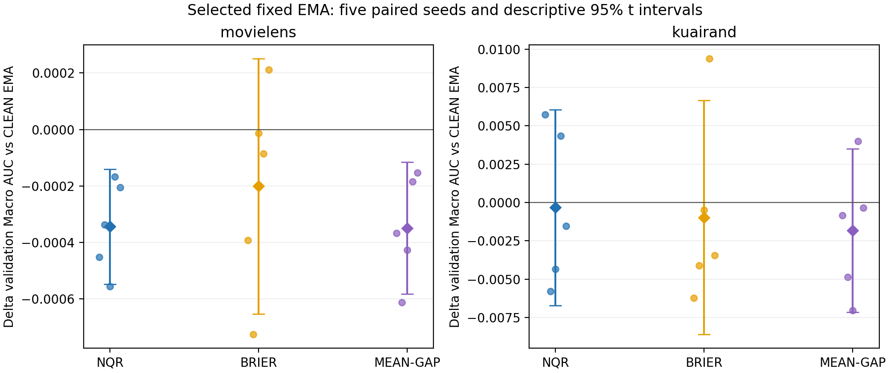
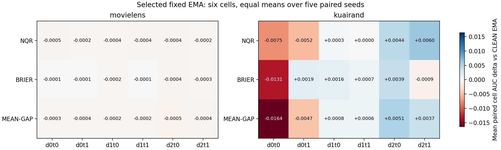

# Cycle02 — Natural quadratic ranking on fixed M3oE

NQR-025 receives **NO_CONTINUATION_SIGNAL**. Its independently selected fixed-EMA validation Macro AUC is below CLEAN on both datasets: MovieLens −0.000343517, KuaiRand −0.000328734. MovieLens declines in all five seeds, with its descriptive paired interval below zero; KuaiRand has two positive and three negative seeds with a wide crossing interval. No candidate qualifies. The next step is publication/context integration and fresh research in the original conversation.

All 30 new trajectories completed: three arms × two datasets × seeds 2022–2026, 50 epochs each, 1500 committed epochs and 51750 Adam/EMA updates. Ten exact CLEAN trajectories were reused. There were 30 completed physical attempts, zero failures and zero missing runs. Test was not accessed. The parent verified and accepted all 30 retained online/EMA selected-state pairs in RAM.

## Protocol and intervention

The model is the frozen M3oE fixed1, three domains × two tasks, embedding16, four experts and FCN [512,256,256,64]. Ordinary training gate inputs remain detached; all source trainable modules, routing and fusion are preserved. Natural populations, splits, preprocessing, initialization, private seed+11000 loader, batch40960, retained tails and FP32 are fixed. Adam uses lr .01, betas(.9,.999), eps1e-8 and coupled WD 1e-4/1e-5 for ML/KR. Fixed EMA rho is .9828205985452511/.995, initialized from online and updated once after each Adam step.

ML train/validation rows are800167/100021; KR2006132/250767. Natural tails are21927/40052. The project environment is Python3.13.5/PyTorch2.9.0+cu126 on two RTX3090 cards, with the existing package lock and source FP32/TF32 settings.

Each estimator independently selects its earliest strict maximum of equally weighted six-cell validation Macro AUC. Selected LogLoss and cells come from that same state. E10/E30/E50 are registered descriptive endpoints. The paired unit is seed, n=5; SD uses ddof1 and intervals use t4=2.7764451051977987. Intervals describe this validation screen; repeated research on the same validation data affects evidence strength.

For cell c=(domain,task), let n be its natural batch count, pi_a its label proportions, w=n/(2B), and mu_a/v_a the differentiable probability mean/centered population variance. Define S=pi1²·mean(BCE1)+pi0²·mean(BCE0). All three new arms train one scalar:

`L=.75*C+.25*sum_c w_c*(S_c+2*pi1*pi0*Q_c)`.

| Arm | Q on a two-class cell | Role |
|---|---|---|
| NQR-025 | .5*((1−mu1+mu0)²+v1+v0) | Registered candidate |
| BRIER-OPPORTUNITY-025 | (1−mu1)²+mu0²+v1+v0 | Opportunity-matched pointwise competitor |
| MEAN-GAP-025 | .5*(1−mu1+mu0)² | Exact removal of the candidate's variance term |

This is an exact O(B) reduction of the registered natural ordered-pair risk, with same-label BCE completion. No sampled pairs, perturbations, additional model evaluations, history channel or new parameters are used. The mixture coefficient budget is one; each task has mass .5. Explicit per-row BCE coefficient is (.75+.25*pi_label)/(2B). Consequently gradient scale and class influence can differ from CLEAN despite unit mass. Missing/one-class cells retain their natural rows; lambda0 and all-single-class identity branches delegate to source CLEAN. The source optimizer and one EMA update are unchanged.

The [seven-file design](../../research_plans/26-11-16_augmentation_gradient_momentum/astra_cycles/cycle_02/DESIGN_SPECIFICATION.md) fixes formulas, branches, APIs and gates. Its [literature/local non-equivalence audit](../../research_plans/26-11-16_augmentation_gradient_momentum/astra_cycles/cycle_02/LITERATURE_AND_NOVELTY.md) relates the square-ranking moments to established work and distinguishes the full objective from historical PAIR/ECCM, NDP, TV and AXIS. Global novelty is unestablished.

## Selected primary results

| Dataset | CLEAN EMA AUC / LL | NQR EMA AUC / LL | Paired AUC mean ± SD | AUC 95% interval | AUC +/− seeds | Paired LL mean; lower in seeds |
|---|---|---|---|---|---|---|
| MovieLens | .759768224 / .524690036 | .759424707 / .526831296 | −.000343517 ± .000163977 | [−.000547122,−.000139912] | 0/5 | +.002141261; 1/5 |
| KuaiRand | .691098041 / .428639572 | .690769307 / .427617542 | −.000328734 ± .005145099 | [−.006717219,+.006059751] | 2/3 | −.001022030; 3/5 |

ML LL interval is [−.000146061,+.004428583]; KR LL interval is [−.004697467,+.002653406]. The registered mean-LL-decrease condition holds on KR, with crossing uncertainty and three improved seeds. It does not establish the primary AUC gain. ML meets the cell-protection threshold but misses the Macro AUC target; KR misses both. Both primary means<=0, so the registered stopping gate is true. Evidence for that numerical gate is **STRONG**; evidence against a useful fixed-protocol ML increment is **MEDIUM**, and the KR directional effect is **WEAK**.

| Seed | ML ΔAUC | ML ΔLL | ML selected NQR/CLEAN epochs | KR ΔAUC | KR ΔLL | KR selected NQR/CLEAN epochs |
|---:|---:|---:|---|---:|---:|---|
|2022|−.000452314|+.004388216|24/23|+.005716875|+.003156224|50/44|
|2023|−.000337574|+.001938477|19/19|−.005795801|+.000224675|24/39|
|2024|−.000556160|+.003111779|20/20|−.004351717|−.000801398|47/32|
|2025|−.000167118|−.000590409|23/28|+.004337420|−.003684515|44/50|
|2026|−.000204418|+.001858241|18/21|−.001550448|−.004005138|50/37|

Every estimator, fixed stage, cell, selected epoch and state hash is in the [numerical appendix](NUMERICAL_APPENDIX.md), [paired seeds](ALL_PAIRED_SEEDS.csv) and [summaries](ALL_PAIRED_SUMMARY.csv).

## Controls and competing mechanisms

All three new arms have negative selected-EMA mean AUC deltas versus CLEAN on both datasets. ML BRIER is −.000200870 (1/5 positive, crossing interval); MEAN-GAP is −.000348939 (0/5, interval [−.000582410,−.000115468]). KR BRIER is −.000977209 (1/5) and MEAN-GAP −.001818484 (1/5), both crossing. ML BRIER/MEAN-GAP LL rises .002802502/.004174857, each 5/5 with above-zero intervals.

| NQR minus control, selected EMA | AUC mean | AUC interval; positive seeds | LL mean; lower seeds |
|---|---:|---|---|
| ML minus BRIER | −.000142647 | [−.000593461,+.000308167]; 1/5 | −.000661241; 4/5 |
| ML minus MEAN-GAP | +.000005422 | [−.000193166,+.000204011]; 2/5 | −.002033597; 4/5 |
| KR minus BRIER | +.000648474 | [−.007847468,+.009144416]; 2/5 | −.001701028; 4/5 |
| KR minus MEAN-GAP | +.001489750 | [−.002523555,+.005503055]; 3/5 | −.001259127; 2/5 |

All four mechanism AUC intervals cross zero: evidence for ranking-specific superiority or a beneficial AUC contribution of variance compression is **WEAK**. ML's variance ablation has a clearer LL effect: NQR−MEAN-GAP LL interval [−.003970645,−.000096548], four lower seeds, **MEDIUM** within this protocol. Both arms still have worse LL than CLEAN. NQR LL is lower than BRIER in four of five seeds on each dataset; the crossing intervals leave its mean loss advantage uncertain. This conditional loss response accompanies the failed primary AUC comparison.

At identical scores Q_R−Q_M=.5*(v1+v0), while Q_B−Q_R=.5*((1−mu1−mu0)²+v1+v0). BRIER changes common-score and variance penalties together. Endpoint contrasts therefore test the complete registered objectives. They do not isolate a pure offset mechanism. In particular, almost unchanged ML AUC after removing the variance term weakens variance compression as the main explanation of its primary decline.

## Domains, tasks, prevalence and baseline performance

| Dataset/domain | Natural train rows | CLEAN domain AUC | NQR Δdomain AUC; positive seeds | NQR Δdomain LL |
|---|---:|---:|---|---:|
| ML d0 |155949|.767958341|−.000319206; 1/5|+.001389059|
| ML d1 |318599|.756878065|−.000385642; 0/5|+.002863305|
| ML d2 |325619|.754468266|−.000325703; 2/5|+.002171418|
| KR d0 |172782|.686547442|−.006386723; 2/5|+.003159024|
| KR d1 |1743898|.715993098|+.000165424; 4/5|−.006196973|
| KR d2 |89452|.670753584|+.005235096; 4/5|−.000028143|

Every domain AUC interval crosses zero. KR d1 LL improves 5/5, interval [−.012200029,−.000193916]; ML d1 LL worsens 5/5, interval [.001555718,.004170893]. These are **MEDIUM** local loss phenomena. KR d2 LL mean is slightly lower, but only 4/5 seeds improve and the interval is wide; the positive AUC mean also has a crossing interval.

| Dataset/task | ΔAUC; positive seeds | ΔLL; lower seeds |
|---|---|---|
| ML task0 |−.000416581; 0/5|+.003874856; 0/5|
| ML task1 |−.000270453; 1/5|+.000407666; 2/5|
| KR task0 |−.000918749; 3/5|+.000354039; 2/5|
| KR task1 |+.000261280; 2/5|−.002398099; 4/5|

ML task0 AUC interval [−.000567384,−.000265778] and LL interval [.000890130,.006859582] repeat a task0 cost already seen in AXIS-EVEN under a different intervention. This is **MEDIUM** evidence of a repeated protocol-local sensitivity, with its causal mechanism still **WEAK**. Other task AUC intervals cross zero.

The smallest ML domain has the highest CLEAN domain AUC yet declines. On KR, the two smaller domains move in opposite directions; the largest domain has near-zero positive mean AUC and a repeated LL improvement. Thus domain size is not supported as the main explanation, and a small-domain-gain/large-domain-decline trade-off is absent in this matrix (**WEAK** causal size evidence).

Class prevalence is a competing explanation worth separating from size. KR d0 positive proportions are .090889/.041214 for task0/1; d1 .377832/.256083; d2 .616867/.484807. The opportunity factor 2*pi1*pi0 therefore differs substantially even before model scores enter. Domain size, label prior, features, task, baseline performance and sharing are confounded here. Baseline AUC measures this model's observed performance; it does not define intrinsic difficulty.

## Stage, estimator and aggregation contradictions

ML E10 fixed-EMA AUC improves .001151311, 5/5, interval [.000005901,.002296722], before selected EMA declines .000343517, 5/5. E30/E50 EMA means are −.000289384/−.000565383, and their LL costs .004108359/.004777301 are both 5/5 with above-zero intervals. Evidence for a transient early AUC response is **MEDIUM**. That descriptive stage response does not qualify the registered selected endpoint.

KR E10 EMA LL falls .008684034, 5/5, interval [−.015201546,−.002166522], while its AUC mean falls .003469898 (1/5 positive). Selected EMA LL is less consistent. E50 online AUC is +.000418423 (3/5, crossing), whereas E50 EMA AUC is −.000501260 (3/5, crossing). This separates ranking, loss, estimator and stage responses.

Selected KR traffic-weighted cell AUC and pooled-task mean AUC rise .000132346/.000278086, each 4/5 with crossing intervals, while equal-cell Macro AUC falls .000328734. Pooled LL falls .006051198, 5/5, interval [−.011964965,−.000137430], largely alongside the dominant d1 loss improvement. ML traffic/pooled AUC falls .000345230/.000547516, each 5/5 with below-zero intervals. The primary remains equal-cell selected EMA Macro AUC.

NQR EMA−CLEAN online is +.002652932 on ML (5/5, interval [.002436237,.002869628]) and +.001315093 on KR (2/5, crossing). The matched EMA component contrasts are negative; selected online−online is also negative on both means (−.000287740/−.000851989). The total EMA comparison cannot attribute its EMA contribution to NQR.

## Diagnostics and explanations left open

At epoch50, the equal-cell average of seed means of class/cell-count-weighted batch statistics gives Q_R−Q_M=.052593148 on ML and .024351039 on KR for NQR. MEAN-GAP's corresponding unpenalized variance statistics are .054942432/.026437920. This is consistent with a change in within-class score variation; the AUC ablation does not establish a useful increment. These are averages of batch statistics, not pooled population variances.

First-batch epoch50 NQR data-gradient L2 means are .185111531/.057132585 for ML/KR; actual Adam/decay update L2 means are 1.210122751/.969153387. BRIER gives .140145239/.055656712 and 1.229160387/.981843728; MEAN-GAP .180858766/.051556971 and 1.205882248/.988545471. Gradient scale, adaptive moments and coupled decay remain competing explanations; these norms do not identify update directions or a unique mediator. Full five-seed values and group diagnostics are retained.

Stable findings: the registered candidate misses CLEAN on both means; ML selected AUC declines in all seeds; ML task0 rank/loss costs recur; KR large-domain/pool loss improves more consistently than Macro AUC. Contradictions: ML early versus selected AUC, KR AUC versus LL, Macro versus traffic/pooled aggregation, and total EMA versus matched-EMA component comparisons.

The most discriminating follow-up for the observed stage response is an equal-exposure temporal intervention: apply the same fixed term only in epochs1–10 or only in epochs41–50, with CLEAN and the constant-term trajectory as controls, preserving the full50-epoch selection protocol. An early-specific advantage would support a phase explanation; similar responses would favor dose/general-path explanations; failure of both would reject transfer of the early descriptive gain. This question goes to fresh Astra alongside other mechanisms, with efficacy and final eligibility decided by a new precommitted experiment. Prevalence/opportunity weighting remains a separate unresolved explanation.

## Execution, revisions and resources

The first code review found one MAJOR: repeated smoke resets aliased saved Adam step/moment tensors. Before any formal training, a fresh coder changed optimizer loading to copy the saved subdict and allowed the review receipt to list all contributing coders. A different fresh reviewer reproduced the populated-state identities, unchanged baseline and restored step1, then passed the repaired source. Six actual full40960/tail/evaluation/RAM cases passed, followed by separate smoke/resource PASS. No formal trajectory was rerun.

Frozen design7 SHA256: `9e5265df52809e45ac186d5c5a4a2b80ac96e4c952ded35eb92f76c1efcccfb4`. Formal source87: `ddaf5d97b676c4c8ba06c40cb2a7aa2209ae27148950b848329e1dc8bb669bae`. Initial failed-review source: `d3f518b8d23cbafa9be0b954de995d0edfeaf12ebab3836cd4a723d3eda9d0a0`. Protected C1 source79 stayed `6b16d5e6bd5fcb96d8824a4161ec102af25e5a23ed86ff21f70d21e05eee5ff1`.

All work used the original conversation, fresh native contexts and file handoffs. Completed contexts were closed. Parent-owned C2 RAM PID1944719/foreground session52263 retains 30 selected pairs, 286526880 tensor bytes; parent independently checked all60 hashes/epochs. Prior owners, source and numeric journals were preserved. No model/optimizer/checkpoint tensor files were written.

All30 recorded launches pass current per-card memory<85%, measured power<85%, hostRAM<90%, no unresolved startup ACK, and physical fit within measured CUDA-usable100%. Maximum prelaunch fractions are 83.6398% memory, 84.4820% power and 69.3295% hostRAM; peak observed hostRAM is 73.0630%. Each first full update completes before allocation ACK and resampling. There is no predicted-power/projected85-memory gate, worker cap or both-card requirement. Actual observed concurrent CUDA workers reached26 (GPU0=15/GPU1=11) with both cards at100% utilization. Across the entire matrix,16 trajectories launched on GPU0 and14 on GPU1. All30 had been admitted before the final trajectories finished.

Full-process formal peaks rose from smoke to 1384120320B ML and1658847232B KR; live profiles raise later admissions. Foreground scheduler duration was2727.231652s (45m27s); summed measured physical worker time47184.695826s (13.106860 worker-hours). Mean worker seconds ML/KR: NQR1061.642499/2331.417086, BRIER945.729041/1882.224006, MEAN-GAP1030.000977/2185.925555. Historical CLEAN means407.738488/1155.568793 were measured under different concurrency; they do not isolate loss-computation overhead. Diagnostic time is included in training-step time. Historical missing cost fields remain null.

## Evidence and next handoff

The [decision](DECISION.json), [resource audit](RESOURCE_EXECUTION_AUDIT.json), [costs](COST_MEANS.csv), [diagnostics](DIAGNOSTIC_MEANS.csv), [statistics](STATISTIC_MEANS.csv), numerical appendix and two figures accompany the report. Raw export has40 trajectories,320 endpoints,4000 estimator-epoch curves,24000 cell-epoch curves,310500 weight rows,99000 statistic rows and1950 diagnostic/group rows. All1500 new epochs are RAM-acknowledged; selected states stay in the parent-owned RAM owner.

**NO_CONTINUATION_SIGNAL**, no champion, final candidate eligibility false; Test remains sealed. The original parent integrates these results into main research context, publishes/verifies the complete report/code/numeric archive, then dispatches fresh Astra for Cycle03. The outer loop has no cycle, experiment or revision cap; only explicit USER_STOPPED normally ends it.
