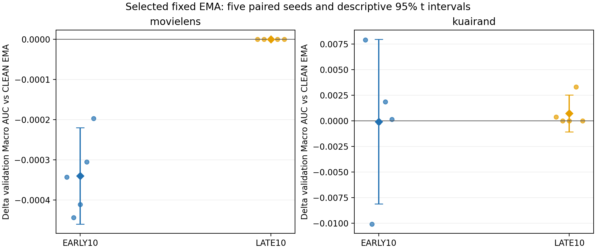
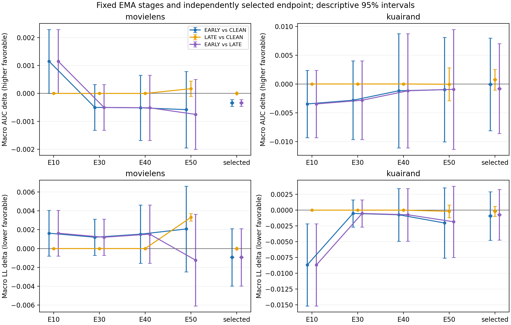
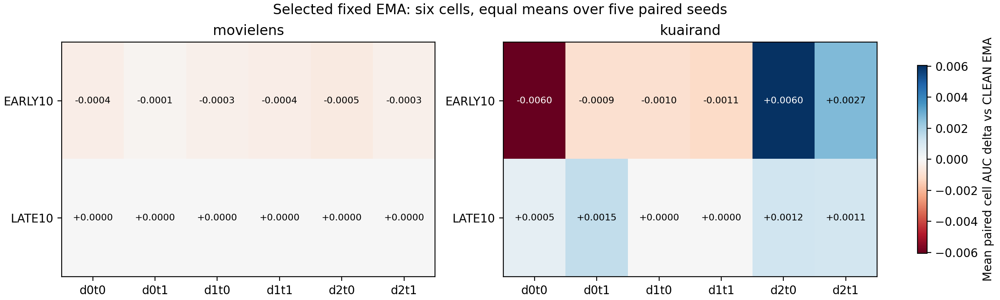

# Cycle03 — Early versus late natural quadratic ranking exposure

**NQR-EARLY10 receives NO_CONTINUATION_SIGNAL.** Relative to CLEAN, independently selected fixed-EMA validation Macro AUC changes by −0.000340045 on MovieLens and −0.000068613 on KuaiRand. MovieLens declines in all five seeds with a below-zero descriptive paired interval; KuaiRand has three positive and two negative seeds and wide uncertainty. Neither dataset meets the +.003 practical target. MovieLens meets the six-cell mean protection threshold; KuaiRand misses it. No candidate is promoted, no champion is selected, and Test remains sealed. The original conversation continues through publication to fresh research.

All twenty new trajectories finished: two arms × two datasets × seeds2022–2026, fifty epochs each, 1000 committed epochs and34500 Adam/EMA updates. Twenty exact numeric controls were reused: ten CLEAN and ten constant NQR-025. All twenty physical attempts completed without failure or scientific replay. The parent directly verified all forty selected-state hashes/epochs/validation records in RAM and accepted twenty retained online/EMA pairs,191017920 tensor bytes.

## Protocol and intervention

The fixed M3oE fixed1 model, three domains/two tasks, embedding16, four experts and FCN[512,256,256,64], routing/fusion and detached ordinary gate inputs are unchanged. Natural populations and splits, train-only preprocessing, source initialization, seed+11000 private loader, FP32, batch40960 including tails, coupled Adam and fixed EMA are preserved. Adam uses lr.01, betas(.9,.999), eps1e-8 and WD1e-4/1e-5 for ML/KR. EMA rho=.9828205985452511/.995 is initialized from online and updated once per Adam step. ML train/validation rows800167/100021; KR2006132/250767; steps per epoch20/49 and tails21927/40052.

The adapter calls the exact frozen Cycle02 NQR operator once per batch. With natural cell weight w=n/(2B), class proportions pi_a, class probability mean mu_a and population variance v_a, its active objective is `.75*C+.25*sum_c w_c*(S_c+2*pi1*pi0*Q_Rc)`, where `S=pi1²*mean(BCE1)+pi0²*mean(BCE0)` and `Q_R=.5*((1−mu1+mu0)²+v1+v0)`. Lambda0 delegates to source CLEAN. There are no additional model evaluations, parameters, algorithm RNG draws, sampled pairs or optimizer/EMA resets.

| Arm | Active epochs, lambda=.25 | Off epochs, lambda=0 | Role |
|---|---|---|---|
| NQR-EARLY10 |1–10|11–50|Registered candidate|
| NQR-LATE10 |41–50|1–40|Equal ten-epoch exposure timing control|
| NQR-025 |1–50|None|Exact reused constant-exposure control|
| CLEAN |None|1–50|Exact reused source control|

These are internal mechanism comparisons on the repository adaptation of published M3oE. CLEAN with fixed EMA is a matched internal source control; it is not an additional formally published baseline model, and this matrix makes no new cross-model benchmark claim.

Across the twenty new runs there are6900 active and27600 off updates;280629900 active and1122519600 off natural rows, and lambda-update sum1725. Each new trajectory has ten active and forty off epochs; ML200/800 and KR490/1960 active/off updates. Equal scheduled row/lambda exposure does not equal realized gradient dose, batch opportunity, Adam history or EMA age. All1000 new permutations match the corresponding reference orders. EARLY's first100 epoch records match constant NQR; LATE's first400 match CLEAN. Exact comparisons include model/EMA/optimizer/order hashes, step and validation. RNG/loader hashes are compared where the historical source contains them; CLEAN did not record those hashes. Populated CPU and real RAM smoke fixtures separately check RNG/restore/activity neutrality.

Both streams independently select the earliest strict maximum of six-cell validation Macro AUC; selected LogLoss/cells use that same state. Registered endpoints are selected/E10/E30/E40/E50. Seed is n=5; SD uses ddof1 and descriptive95% intervals use t4=2.7764451051977987. Datasets, epochs, cells and streams are not extra replicates. Repeated validation adaptation constrains scientific evidence strength. The [seven-file design](../../research_plans/26-11-16_augmentation_gradient_momentum/astra_cycles/cycle_03/DESIGN_SPECIFICATION.md) and [novelty/literature audit](../../research_plans/26-11-16_augmentation_gradient_momentum/astra_cycles/cycle_03/LITERATURE_AND_NOVELTY.md) define the registered claims; global novelty is unestablished.

## Selected primary and all five seeds

| Dataset | CLEAN EMA AUC / LL | EARLY EMA AUC / LL | ΔAUC mean ± SD | AUC95% interval | AUC positive/negative | ΔLL; lower seeds |
|---|---|---|---|---|---|---|
|MovieLens|.759768224 / .524690036|.759428179 / .523761485|−.000340045 ± .000096598|[−.000459987,−.000220103]|0/5|−.000928551;3/5|
|KuaiRand|.691098041 / .428639572|.691029428 / .427710667|−.000068613 ± .006486194|[−.008122287,+.007985061]|3/2|−.000928905;2/5|

ML LL interval[−.003972442,+.002115340] and KR[−.004760197,+.002902387] cross zero. Both loss means are lower, but only three/two seeds improve. The minimum six-cell mean AUC changes are−.000535147/−.006049390 for ML/KR; the protection threshold is−.001. Both primary AUC means are nonpositive, so the registered gate is true (**STRONG numerical evidence**). The repeated small ML AUC decline is **MEDIUM** protocol-local evidence; KR's directional effect is **WEAK**. Mean loss improvement does not rescue failed primary AUC.

| Seed | ML ΔAUC | ML ΔLL | EARLY/CLEAN EMA epochs | KR ΔAUC | KR ΔLL | EARLY/CLEAN EMA epochs |
|---:|---:|---:|---|---:|---:|---|
|2022|−.000342717|+.002095693|26/23|+.007931261|+.001454758|47/44|
|2023|−.000443659|−.000743471|20/19|−.010094463|+.001703966|24/39|
|2024|−.000411039|+.000118159|20/20|−.000180455|−.003017448|46/32|
|2025|−.000305386|−.004590490|21/28|+.001857491|+.000507234|29/50|
|2026|−.000197426|−.001522645|18/21|+.000143102|−.005293034|50/37|

The [numerical appendix](NUMERICAL_APPENDIX.md), [18020 paired seed rows](ALL_PAIRED_SEEDS.csv), [3604 paired summaries](ALL_PAIRED_SUMMARY.csv) and [endpoint means](ENDPOINT_MEANS.csv) retain every registered metric, stream, endpoint, state hash and cell.

## Timing, constant exposure and the selection bound

The precommitted timing contrast is **fixed E50 EARLY minus LATE**, evaluated separately online and EMA.

| Dataset/stream | ΔAUC | AUC95% interval; positive seeds | ΔLL; lower seeds |
|---|---:|---|---|
|ML online|−.000139590|[−.002283484,+.002004304];3/5|−.003168567;5/5|
|ML EMA|−.000750982|[−.002003424,+.000501459];1/5|−.001229674;3/5|
|KR online|+.001469902|[−.005034561,+.007974364];3/5|−.000813063;2/5|
|KR EMA|−.000934445|[−.011358999,+.009490108];3/5|−.001844481;2/5|

All four AUC and LL timing intervals cross zero. ML's online/EMA and KR's EMA mean AUC do not support the directional EARLY advantage. KR's online positive mean changes sign for EMA; its three positive EMA seeds do not make the EMA mean positive. The present timing attribution is **WEAK**, and crossing intervals do not establish equivalence.

At selected EMA, EARLY minus constant NQR AUC is+.000003472 on ML (3/5 positive, CI[−.000152890,+.000159833]) and+.000260121 on KR (3/5,CI[−.004106110,+.004626352]). ML LL improves−.003069812 in5/5,CI[−.003884638,−.002254986], **MEDIUM** evidence that stopping the continued intervention changes loss without restoring selected rank performance. KR LL differs+.000093125, three lower seeds but a crossing interval. At E50 EMA the EARLY−constant AUC means are−.000015545/−.000487518, both crossing. Thus forty off epochs do not preserve the motivating ML early AUC benefit or materially resolve its selected AUC deficit versus CLEAN. This weakens an explanation requiring continued late NQR exposure as the sole cause of that deficit; early parameter/Adam path changes and objective/class weighting remain competitors.

LATE selected ML EMA equals CLEAN in all five seeds, including exact selected states and epochs23,19,20,28,21. All lie in its identical first40-epoch prefix. The guaranteed nondecrease from retaining these maxima is a **selection bound**, not a new efficacy gain. Its selected advantage+.000343517 over failed constant NQR (5/5,below-zero reciprocal interval) does not demonstrate a useful late intervention. On KR, LATE−CLEAN selected EMA is+.000738140,CI[−.001061581,+.002537862], two positive and three exact-zero seeds. LATE selects47/39/32/50/37; the three pre41 states are retained CLEAN optima. The two post40 seeds improve+.000376141/+.003314562. This weaker local counterexample is preserved (**WEAK**); the control cannot replace the registered candidate.

EARLY E10 is exactly constant NQR by construction, including its ML AUC+.001151311 (5/5) and KR AUC−.003469898/LL−.008684034 (LL5/5 lower). These repeat the same trajectories, not independent replications. Later EARLY−CLEAN EMA AUC means at E30/E40/E50 are ML−.000500832/−.000515172/−.000580928 and KR−.002829198/−.001181461/−.000988778, all crossing intervals. ML E50 LL mean becomes+.002076602, four higher seeds, despite the lower selected LL mean. The failure is endpoint-dependent as well as metric-dependent.

## Domains, tasks, baseline and size

| Dataset/domain | Natural train rows | CLEAN selected EMA AUC / LL | EARLY ΔAUC; positive seeds | EARLY ΔLL |
|---|---:|---|---|---:|
|ML d0|155949|.767958341 / .513736438|−.000264630;1/5|−.000975463|
|ML d1|318599|.756878065 / .528493342|−.000343863;1/5|−.000427388|
|ML d2|325619|.754468266 / .531840327|−.000411642;2/5|−.001382802|
|KR d0|172782|.686547442 / .219955072|−.003499683;2/5|+.000329756|
|KR d1|1743898|.715993098 / .419347169|−.001043873;3/5|+.000554337|
|KR d2|89452|.670753584 / .646616475|+.004337717;3/5|−.003670807|

All six domain AUC and LL intervals cross zero. KR d0 interval[−.031148063,+.024148697] is particularly wide. Its two smaller domains again have opposite mean AUC directions, while the largest has a negative mean here. This is not a uniform small-domain gain/large-domain decline trade-off. ML's smallest domain has the highest baseline AUC and still declines. Size is not identified as the main explanatory variable (**WEAK causal evidence**); baseline scores describe this fixed model's observed difficulty rather than intrinsic difficulty.

| Dataset/task | EARLY ΔAUC; positive seeds | EARLY ΔLL; lower seeds |
|---|---|---|
|ML task0|−.000408706;1/5|−.000986610;4/5|
|ML task1|−.000271384;1/5|−.000870492;3/5|
|KR task0|−.000336107;3/5|−.001132679;4/5|
|KR task1|+.000198881;3/5|−.000725131;2/5|

ML task0 AUC interval[−.000803665,−.000013747] continues the local rank sensitivity seen in AXIS-EVEN and constant NQR. Its mean LL is now lower and interval crosses zero; the earlier joint rank/loss cost is not fully repeated. Other task AUC intervals cross zero. The repeated rank pattern is **MEDIUM**, its cause remains **WEAK**.

KR positive proportions by task are d0 .090889/.041214, d1 .377832/.256083, d2 .616867/.484807. Natural opportunity2*pi1*pi0, label prior, features, task sharing, model scores and update history differ jointly with size. ML task0 prevalence is .561042/.563263/.602149 across domains, task1 .234788/.220208/.239565. These observed differences are plausible competitors, not causal conclusions.

Selected ML traffic-weighted AUC−.000347722 and pooled-task AUC−.000446943 both decline5/5 with below-zero intervals. KR traffic/pooled AUC means−.001030685/−.000957291 have three positive seeds and crossing intervals. KR pooled LL mean+.000520874 contrasts with equal-cell Macro LL−.000928905, both uncertain. Constant NQR's prior dominant-d1/pool loss improvement does not recur consistently after the early-only schedule. Aggregation cannot replace the primary equal-cell result.

EARLY EMA minus CLEAN online AUC is+.002656404 on ML (5/5,CI[+.002385285,+.002927523]) and+.001575214 on KR (4/5,crossing). EARLY selected online minus CLEAN online is negative in both means (−.000293829/−.000451934); matched EMA increments are also negative. The total comparison includes ordinary EMA's contribution and cannot attribute it to EARLY NQR.

## Diagnostics, competing explanations and next discrimination

There are120 new first-batch diagnostic observation points at1/10/11/40/41/50, with full group records and explicit historical availability. CLEAN norms and constant NQR11/41 measurements are unavailable; they remain null. EARLY E10 norms equal constant NQR exactly. On ML EARLY data-gradient/update L2 means change from .105227/1.280847 atE10 to .100925/1.260384 atE11, and .209750/1.212699 atE50. On KR they change .056816/1.034315 to .144504/1.120289, then .063831/.983828. Different batches and model states prevent these across-epoch values from identifying the causal switch effect or cumulative gradient dose. They do not establish directions or gradient conflict.

Stable repeated phenomena are the ML selected rank deficit despite a favorable identical early endpoint; local task0 rank sensitivity; and failure of the registered cross-dataset primary claim. Contradictions include selected loss recovery versus unchanged AUC relative to constant exposure; E50 online versus EMA timing on KR; retained-prefix selected LATE equality versus altered later states; and Macro versus pooled KR loss. Constant NQR's ML task0 LL cost and KR large-domain LL improvement do not survive unchanged under EARLY. TV MLgamma.20 and AXIS KR-IID2 retain small positive mean AUC counterexamples with crossing intervals; history does not justify assuming all interventions or all datasets necessarily fail.

The evidence weakens the proposed early-gain preservation mechanism under this exact protocol (**MEDIUM** for ML; **WEAK** for KR/timing). It does not isolate whether rank costs arise from class/opportunity completion weighting, the quadratic ranking gradient, early Adam/parameter path dependence, EMA recency, or generic disturbance of a competitive fixed baseline. Equal scheduled exposure alone cannot distinguish these. No curriculum, momentum or domain-difficulty benefit is assumed.

The next most discriminating question is to separate the NQR objective's natural class/opportunity completion weighting from its actual ranking-gradient contribution while retaining a matched CLEAN/EMA/optimizer protocol, rather than selecting another favorable epoch. A counterfactual that preserves the weighting but removes the ranking contribution, with an appropriate fixed gradient-scale/path competitor, would test whether the observed rank deficit is ranking-specific. Fresh Astra must compare this with at least two mathematically distinct mechanisms and choose a falsification-oriented registered design; this report does not preapprove a new algorithm or HPO sweep.

## Execution, revisions, resources and retention

Frozen source94 SHA256 `a7666566be5790a0e97613d11c37792122a4028f72716669f52be1ceffe99002`; seven-file design `fe784adac9005f29b230e019b5e0fcd9c98dc842c1ac4ebe12849ba90512f3bb`. The frozen Cycle02/Cycle01 sources and old numeric inventories stayed unchanged. Two fresh coders completed independent scopes, then a distinct code reviewer passed. Four real GPU/RAM smoke cases covered both arms/datasets on both cards, populated on/off transitions, true full/tails, ten physical calls per case, two engineering commits/recovery, zero scientific epochs. Distinct resource review passed before formal RUN.

The first formal runner did not start because its legacy role developer instructions hardcoded seeds2022–2025. start.md explicitly requires2022–2026. That completed context was closed; its NOT STARTED report is preserved. A fresh native Luna/high context executed the approved five-seed manifest unchanged. No global role configuration or algorithm/source/design changed; no repeated scientific training was needed. [Role-resolution receipt](../../artifacts/26-11-16_augmentation_gradient_momentum/astra_cycles/cycle_03/RUNNER_ROLE_RESOLUTION.json) and both runner reports preserve the distinction. Subsequent RUN dispatches must use the same fresh five-seed-compatible native context to avoid this stale role conflict.

All twenty admissions satisfy independently current card memory<85%, current power<85%, hostRAM<90%, no unresolved allocation ACK, and measured full-process physical fit within CUDA-usable100%. Maximum prelaunch fractions are73.9014% memory,81.9106% power,51.4507% hostRAM; peak measured hostRAM61.0358%. Twenty real CUDA processes ran concurrently, ten on each card, with both cards near100% utilization. All twenty were launched within39.416s. There was no predicted-power/projected85-memory condition, fixed worker cap or both-card gate. Declining concurrency at the end reflects completed trajectories, with no queued jobs.

Smoke full-process peaks ML1384120320/KR1749024768B; formal peaks1384120320/1658847232B. Foreground RUN2091.845419s (34m51.8s), summed physical worker time30214.9099998s (8.393031 worker-hours). ML EARLY/LATE mean worker seconds987.808336/991.810575; KR2003.138192/2060.224898. Historical runs used different concurrency; these times do not identify isolated algorithm overhead or speedup. Diagnostic time is included in step time; unavailable historical cost fields remain null.

Parent-owned foreground RAM PID2097722/session61982 retains twenty selected pairs191017920B after direct acceptance; old owners1025015/1570727/1944719 and their selected states remain protected. All children use fresh independent native contexts in the original conversation and are permanently closed after handoff. There are no detached/headless AI sessions and no tensor checkpoint files.

## Evidence package and continuation

The [decision](DECISION.json), [execution audit](RESOURCE_EXECUTION_AUDIT.json), [costs](COST_MEANS.csv), [diagnostics](DIAGNOSTIC_MEANS.csv), [statistics](STATISTIC_MEANS.csv) and [selection structure](SELECTION_STRUCTURE.csv) accompany this report. Raw export contains40 trajectories,400 endpoints,2400 endpoint cells,4000 estimator-epoch curves,24000 cell curves,1000 new epoch phase records,34500 new schedules,207000 new weights,66000 new statistics and2300 diagnostic/group/availability rows. Historical rows are marked reused and do not inflate new useful updates. The [archive and control mapping](DATA_AVAILABILITY.md) preserve all new numeric records plus20 reused numeric controls and historical diagnostic batch sources; guardian credentials and all tensors are excluded.

**NO_CONTINUATION_SIGNAL; no champion; final candidate eligibility false; Test sealed.** Complete report/context publication and actual remote-main verification precede fresh Astra Cycle04. The unattended outer loop has no cycle, experiment or revision cap. Only explicit USER_STOPPED normally terminates it; candidate rejection continues research.
