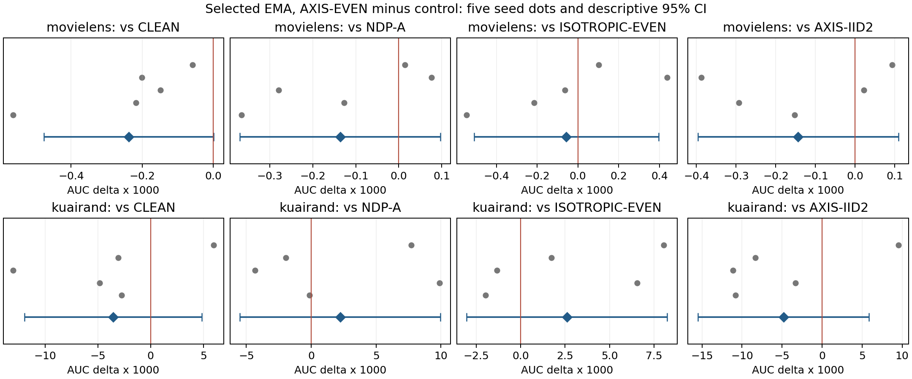
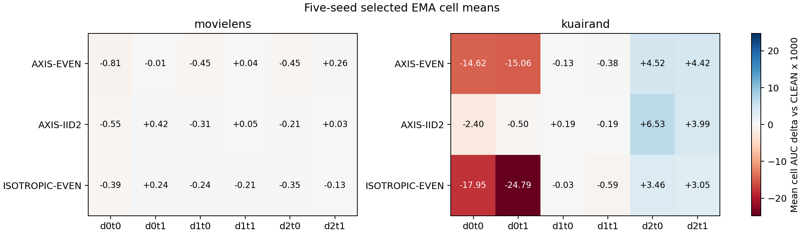

# Task-axis even views：cycle01 完整分析

## 决定与完整性

**NO_CONTINUATION_SIGNAL。** 注册候选 AXIS-EVEN 相对 CLEAN 的 selected fixed-EMA 六格 Macro AUC，在 MovieLens 和 KuaiRand 的五 seed 均值分别为 −0.000237520、−0.003540710。预注册的“两数据集均值均非正”条件触发；本轮不进行 HPO 或追加确认，不升级 champion。当前会话继续报告、上下文发布和 fresh Astra 研究循环。

30/30 新轨迹全部完成：两个数据集、三个新臂、seeds2022–2026、每条50epochs，共1500个已提交epoch、51750次Adam和51750次EMA更新。20条历史 CLEAN/NDP-A 精确复用；合计50条轨迹、400个选点/共同epoch终点。Test保持封存。原始导出已核对每个seed的初始化、全50epoch loader顺序、独立online/EMA最早严格最大值选点及对应状态hash。主分析再次对照全部配对差、SD、描述性CI及正/负/零计数。

本报告的效应方向均为候选减控制；AUC差为正有利，LogLoss差为负有利。统计单位是seed，n=5，SD使用ddof=1，95%区间系数为2.7764451051977987。共同epoch及多个单元是同一训练轨迹的相关读出。

## 方法和比较

M3oE fixed1，3域×2任务，自然80/10/10划分及train-only预处理，FP32、batch40960含自然尾批，单coupled Adam和每步一次固定EMA。MovieLens/KR的weight decay分别为1e-4/1e-5，EMA rho分别为0.9828205985452511/0.995。

AXIS-EVEN保留NDP-A的task-specific probe及实际扰动范数，对各task使用同一方向的±两视图；AXIS-IID2使用每row/task/replica独立Rademacher符号；ISOTROPIC-EVEN使用相同实际范数的Gaussian方向±视图。四视图按自身task计算BCE；总损失为0.75C+0.25V，保留全部自然2B支持及总质量，每批只有一次Adam/EMA更新。视图扰动detach，普通embedding lookup可训练，训练gate detach及probe全gate导数保持源定义。

注册主比较是 AXIS-EVEN−CLEAN 的 selected fixed-EMA Macro AUC，两个数据集分别裁定。机制比较是 AXIS-EVEN−NDP-A、−ISOTROPIC-EVEN、−AXIS-IID2。其他新臂保留其完整结果，研究候选的注册身份保持不变。

设计与历史不等价分析见 [执行规范](../../research_plans/26-11-16_augmentation_gradient_momentum/astra_cycles/cycle_01/CODEX_EXECUTION_PLAN.md) 和 [设计补充](../../research_plans/26-11-16_augmentation_gradient_momentum/astra_cycles/cycle_01/DESIGN_COMPLETENESS_ADDENDUM.md)。训练源码hash为6b16d5e6bd5fcb96d8824a4161ec102af25e5a23ed86ff21f70d21e05eee5ff1；最终调度入口hash为b7eeba76d21727b596897eec84e0e5766c01e8a41fba832c1036d38bdf7c6f3f。

## 主终点、seed一致性与损失

| 数据集 | ΔMacro AUC | seed SD | 描述性95%CI | 正/负seed | ΔMacro LogLoss | LL改善seed |
| --- | ---: | ---: | --- | --- | ---: | --- |
| MovieLens | −0.000237520 | 0.000192296 | [−0.000476287, +0.000001248] | 0/5 | +0.001264852 | 0/5 |
| KuaiRand | −0.003540710 | 0.006759211 | [−0.011933378, +0.004851958] | 1/4 | −0.000386070 | 2/5 |

MovieLens五个AUC差依次为−0.000563022、−0.000217788、−0.000147944、−0.000200754、−0.000058090。AUC的均值区间刚跨零；LL的区间为[+0.000054745,+0.002474958]。方向一致性支持本固定设置下无排序增量，不能将AUC区间写成严格低于零。证据强度 **MEDIUM**。

KuaiRand的五个AUC差依次为−0.002754143、−0.004834160、−0.013019973、−0.003060842、+0.005965568。seed2024的下降与seed2026的上升并存，区间较宽。LL均值降低，但仅2/5 seed改善，区间跨零。平均损失改善不能代替主排序终点。未形成稳定增量的证据为 **MEDIUM**；具体负效应幅度及解释为 **WEAK**。注册停止条件的触发是完整矩阵中的直接事实（**STRONG**）。

| selected EMA Macro AUC均值 | CLEAN | NDP-A | AXIS-EVEN | AXIS-IID2 | ISOTROPIC-EVEN |
| --- | ---: | ---: | ---: | ---: | ---: |
| MovieLens | 0.759768224 | 0.759666968 | 0.759530704 | 0.759674179 | 0.759587367 |
| KuaiRand | 0.691098041 | 0.685322722 | 0.687557331 | 0.692367593 | 0.684956117 |

KuaiRand的AXIS-IID2−CLEAN均值为+0.001269552，2/5正、3/5负，CI[−0.005028929,+0.007568033]，属于 **WEAK** 条件信号。它必须随报告保留，故不能把本轮写成“所有新臂在所有数据集均非正”；也不据此更换注册候选。

## 三项机制比较

| 对照 | ML ΔAUC，正seed/5 | KR ΔAUC，正seed/5 |
| --- | --- | --- |
| NDP-A | −0.000136264，2/5 | +0.002234609，2/5 |
| ISOTROPIC-EVEN | −0.000056663，2/5 | +0.002601214，3/5 |
| AXIS-IID2 | −0.000143475，2/5 | −0.004810262，1/5 |

上述六个区间均跨零。去除odd部分后，KR相对NDP-A仅出现均值恢复，ML方向反而为负；跨数据集的odd-component终点预测没有得到一致支持。task-axis相对匹配norm随机轴的排序优势也未建立。antithetic相对IID2的均值在两数据集均为负，配对优于独立符号的方向性预测未满足。三项性能机制证据均为 **WEAK**；区间跨零表示未解决，不能解释成机制等价。

## 域、任务、规模与基线表现

下表均为selected EMA；域AUC是域内两task等权均值。CLEAN AUC用于描述此模型/协议的基线表现，仍与标签、特征结构和训练状态混杂。

| 数据集/域 | 训练行数 | CLEAN域AUC | Δ域AUC | AUC正seed/5 | Δ域LL |
| --- | ---: | ---: | ---: | --- | ---: |
| ML d0 | 155949 | 0.767958341 | −0.000410621 | 0/5 | +0.001537793 |
| ML d1 | 318599 | 0.756878065 | −0.000206994 | 2/5 | +0.000311378 |
| ML d2 | 325619 | 0.754468266 | −0.000094945 | 2/5 | +0.001945385 |
| KR d0 | 172782 | 0.686547442 | −0.014842276 | 1/5 | +0.002073608 |
| KR d1 | 1743898 | 0.715993098 | −0.000251429 | 3/5 | +0.001303220 |
| KR d2 | 89452 | 0.670753584 | +0.004471575 | 4/5 | −0.004535039 |

MovieLens最小域d0基线AUC最高，却下降最多；d0域AUC的CI为[−0.000639938,−0.000181303]，d0t0为−0.000808173且5/5负。task0 Macro AUC为−0.000570378、5/5负、CI不跨零，LL为+0.002315558、5/5变差；task1 AUC为+0.000095338、仅2/5正、CI跨零。稳定局部退化证据 **MEDIUM**，损失主要落在task0。

KuaiRand两个较小域方向相反：d0明显负均值、d2正均值；最大域d1接近零。d2 AUC区间跨零，而d2域LL五seed均降低，CI[−0.008526456,−0.000543621]。两个task的Macro AUC均值分别为−0.003408255、−0.003673165，均1/5正。d0的负向贡献大于d2的正向贡献，形成较大的Macro下降。

**域大小不足以单独解释该模式（WEAK因果证据）。** ML最小域退化、KR两个较小域反向、最大域近零，共同反对统一的“小域改善/大域下降”描述。KR存在d2改善/d0下降的域间交换，但它发生在两个较小域之间。规模、域身份、task、基线表现和训练阶段未被独立操纵。

完整六格AUC/LL、域/任务及CI见 [DOMAIN_TASK_PAIRED.csv](DOMAIN_TASK_PAIRED.csv) 与 [数值附录](NUMERICAL_APPENDIX.md)。

## 训练阶段与聚合口径的反例

| fixed-EMA AXIS-EVEN−CLEAN | E10 Macro AUC | E30 Macro AUC | E50 Macro AUC | selected Macro AUC |
| --- | ---: | ---: | ---: | ---: |
| MovieLens | +0.000229898 | −0.000299999 | −0.000262661 | −0.000237520 |
| KuaiRand | −0.002943240 | −0.004688941 | −0.003994395 | −0.003540710 |

ML的E10均值正但仅2/5正，后续EMA主读出均值转负；E30 online Macro AUC为−0.000647792且5/5负。selected online为−0.000060277，LL均值为−0.000559189，和selected EMA的LL恶化方向不同。selected EMA平均选点为AXIS-EVEN20.8/CLEAN22.2epochs，独立online/EMA选点及训练阶段必须分别报告。

KR selected online的Macro为−0.002994365，而Traffic/Pooled为+0.000227419/+0.000280892；E50 EMA的Macro为−0.003994395，而Traffic/Pooled为+0.000101160/+0.000297800。selected EMA Macro/Traffic/Pooled则均为负。聚合与阶段改变可以产生正值，不能替代注册主终点；也不能只用最终epoch解释selected结果。KR selected EMA worst-cell AUC为−0.007799643，CI跨零。

## 诊断、竞争解释与区分实验

所有臂保持同源初始化、loader顺序、自然支持与质量。full-batch及自然尾批的null/source和one-sided/NDP-A状态等价检查已通过。实际扰动norm匹配与这些实现事实的证据为 **STRONG**。

同一状态下，记V+=(plus task views)，V−=(minus task views)，E=(V++V−)/2−C，O=(V+−V−)/2，则AXIS-EVEN为C+0.25E，源单侧目标为C+0.25E+0.25O。条件于共同状态和probe，IID2的期望目标等于even目标；有限符号样本与后续Adam轨迹仍可不同。

首批诊断的五seed均值在epoch50为：ML轴向E=0.000186121、O=0.012926686；KR轴向E=0.000063175、O=0.008521420。匹配norm的isotropic E分别约0.000001854/0.000000137。轴向确实激发更大的局部损失响应，但这种局部结构没有转化成稳定的注册排序增量。诊断为各seed指定epoch的首批观测，不能把batch/epoch作为额外独立重复。

并存解释包括：确定性even正则对某些task/域带来偏置；有限view噪声改变非凸优化及Adam路径；EMA与选点对局部变化的响应；域特征/标签结构与规模混杂。当前结果既不能把NDP-A全部损失归于odd项，也没有支持额外动量或curriculum已有效。

最有区分力的下一问题是：**IID2的条件均值相同但轨迹不同，差异主要来自均值正则还是梯度噪声路径？** fresh Astra应设计同源自然支持、相同预算的matched zero-mean gradient-noise与deterministic mean-view控制，以CLEAN选点EMA为主比较，同时量化共同状态的梯度均值/方差和实际Adam更新。噪声控制复现IID2现象会支持路径解释；失败会削弱该解释。当前IID2正均值仅为WEAK证据，故该问题用于否证竞争解释，不进行本候选的事后半径搜索。

## 执行成本与恢复

正式运行39个物理attempt：30 COMPLETE、8 PAUSED、1 FAILED。累计实测62771.077 worker-seconds（17.436 worker-hours）；首worker启动到末worker退出为19518.867秒（5小时25分19秒，含中间准入修正/恢复等待）。没有缺失terminal cost。AXIS-EVEN每run平均worker时间为ML780.374秒/KR3017.533秒；不同臂处于不同并发负载，耗时用于执行成本记录。

初始调度额外叠加预测GPU峰值，偏离start.md的当前占用准入规则；修正后两卡各4个worker实际并发。之后GPU1新进程在首epoch前发生一次CUDA OOM。实测CUDA可用容量24135.1875MiB小于NVML24576MiB，且完整进程包含非torch驻留；最终保留当前显存/功耗<85%、RAM<90%的逐卡准入，并检查新进程能否装入实际可用容量。具体证据见 [容量修正](../../artifacts/26-11-16_augmentation_gradient_momentum/astra_cycles/cycle_01/PHYSICAL_CAPACITY_CORRECTION.md) 与 [物理attempt成本](../../artifacts/26-11-16_augmentation_gradient_momentum/astra_cycles/cycle_01/attempt1/tables/PHYSICAL_ATTEMPTS.csv)。

七条已提交轨迹从其RAM ACK epoch恢复；失败项的epoch0没有提交状态，按已审查的源恢复规则重新初始化。已完成轨迹未重跑，算法/数据/50epoch预算/FP32未改。全部阶段及子智能体均在本会话，子任务完成即关闭，原父会话拥有同一前台RAM owner。

## 后续交接

当前30组选点状态已由父会话接管，Test保持封存。先发布本报告、完整数表和实质上下文更新，再派发全新native Astra读取本轮、TV-GRM及NDP-A完整历史，探索下一设计；normal termination仍仅为USER_STOPPED。候选NO-GO不结束循环。

原始终点/曲线、source/table receipts、恢复与发布定位见 [DATA_AVAILABILITY.md](DATA_AVAILABILITY.md)。复现数值分析使用本目录 ANALYSIS.py，图使用 FIGURES.py。
